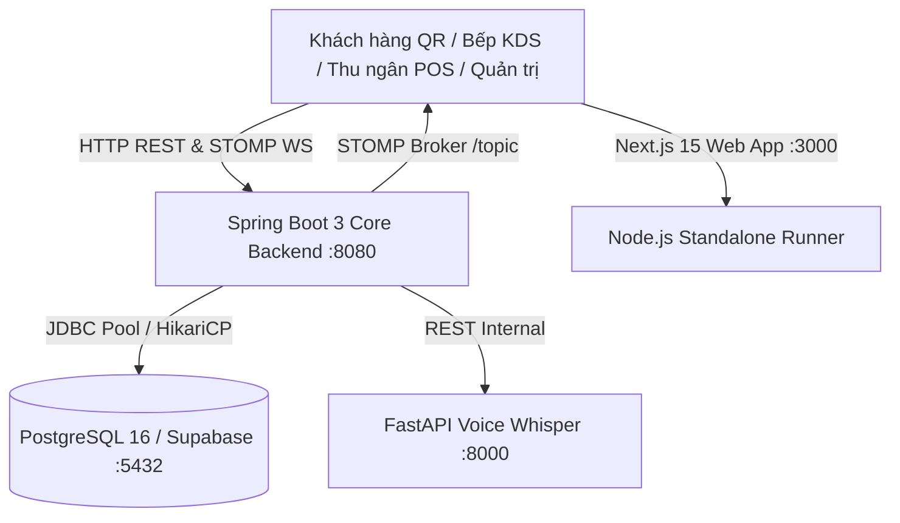

<div align="center">

# 🍽️ Restaurant OS
**Hệ Điều Hành Quản Trị & Vận Hành Nhà Hàng F&B Toàn Diện Thế Hệ Mới**

[](https://github.com/MaiLuong1906/Restaurant-OS/actions/workflows/ci-quality-gate.yml)
[](https://opensource.org/licenses/MIT)
[](https://nextjs.org/)
[](https://spring.io/projects/spring-boot)
[](https://fastapi.tiangolo.com/)
[](https://www.docker.com/)

<p align="center">
  Nền tảng Monorepo tích hợp toàn diện: <b>QR Table Order</b> &bull; <b>Bếp KDS Realtime (&lt;50ms)</b> &bull; <b>Thu Ngân POS</b> &bull; <b>Định Lượng Kho BOM</b> &bull; <b>AI Whisper</b>
</p>

[Khởi Chạy Nhanh](#-khởi-chạy-nhanh-quick-start) &bull;
[Kiến Trúc](#-kiến-trúc-hệ-thống--cấu-trúc-monorepo) &bull;
[Cổng Dịch Vụ & Swagger](#-cổng-dịch-vụ--tài-liệu-api) &bull;
[Kiểm Thử](#-bộ-lệnh-kiểm-thử-toàn-diện-testing) &bull;
[Quy Chuẩn Kỹ Thuật](#-bộ-quy-chuẩn-kỹ-thuật-bất-biến-invariants) &bull;
[Đóng Góp](#-quy-trình-đóng-góp-contributing)

</div>

---

## 📌 Giới Thiệu Tổng Quan

**Restaurant OS** là nền tảng Monorepo vận hành nhà hàng hiện đại, giải quyết triệt để bài toán đồng bộ dữ liệu thời gian thực giữa Khách hàng — Nhà bếp — Quầy thu ngân — Kho nguyên vật liệu:

- **Gọi món tại bàn qua mã QR:** Khách hàng duyệt menu mượt mà, tùy chọn topping, gửi đơn thẳng tới bếp không cần chờ nhân viên.
- **Màn hình Bếp KDS siêu nhạy (&lt;50ms):** Sử dụng STOMP over WebSocket, giao diện nền tối chuyên dụng `#0B0F14` chống mỏi mắt, phím bấm cảm ứng lớn $\ge 48\text{px}$, tính năng gom món tự động (**Dish Batching**).
- **Quản lý Định lượng Kho (BOM - Bill of Materials):** Tự động trừ nguyên vật liệu thô (thịt bò, bún, nước dùng) chính xác theo từng suất ăn ngay khi bếp hoàn thành chế biến, cảnh báo thiếu hàng tức thì.
- **Trợ lý Voice-to-Order AI:** Tích hợp mô hình OpenAI Whisper bóc tách giọng nói gọi món của nhân viên phục vụ thành đơn hàng có cấu trúc.

---

## 🏛️ Kiến Trúc Hệ Thống & Cấu Trúc Monorepo

Hệ thống được thiết kế theo kiến trúc Microservices phân tách độc lập, điều phối tập trung trong Monorepo:



### Cấu Trúc Thư Mục Dự Án:

```text
restaurant-os/
├── frontend/                          # Ứng dụng Next.js 15 (App Router) + React 19 + Tailwind v4 + Zustand
│   ├── src/
│   │   ├── app/                       # Route Groups: (customer), (staff), (admin)
│   │   │   ├── (customer)/            # Khách quét QR (/qr/[tableId]) & Thực đơn (/menu)
│   │   │   ├── (staff)/               # Màn hình Bếp KDS (/kds) & Quầy thu ngân (/pos)
│   │   │   └── (admin)/               # Báo cáo doanh thu & Kho BOM (/dashboard)
│   │   ├── lib/                       # api-client (X-Request-ID), stomp.ts (WebSocket), utils.ts
│   │   ├── stores/                    # Zustand Store: useCartStore, useKdsStore
│   │   └── types/                     # TypeScript Domain Models & DTO (Tiền tệ integer VND)
│   └── Dockerfile & .npmrc            # Đóng gói Standalone Runner tối ưu dung lượng (~100MB)
│
├── backend/                           # Dịch vụ nghiệp vụ lõi Spring Boot 3.3.4 + Java 21 LTS
│   ├── src/main/java/com/restaurantos/
│   │   ├── controller/                # HealthController, DishController (REST API)
│   │   ├── entity/ & repository/      # JPA Hibernate & Spring Data JPA
│   │   ├── config/                    # OpenApiConfig (Swagger UI), WebSocketConfig (STOMP), CorsConfig
│   │   └── common/dto/                # ApiResponse wrapper chuẩn hoá theo Rule 06
│   ├── src/main/resources/
│   │   ├── db/migration/              # Flyway Migrations (V1__init_schema.sql)
│   │   └── application.yml            # Cấu hình Spring Boot & Actuator
│   ├── mvnw & mvnw.cmd                # Maven Wrapper 3.9 độc lập môi trường
│   └── Dockerfile                     # Multi-stage Eclipse Temurin JDK 21 -> JRE 21
│
├── ai-service/                        # Microservice Xử Lý Âm Thanh Python 3.11 + FastAPI
│   ├── main.py                        # Endpoint /health, /api/v1/voice/transcribe-order
│   ├── requirements.txt               # FastAPI, Uvicorn, Whisper stub
│   └── Dockerfile                     # Python 3.11-slim container
│
├── .github/                           # Tự động hóa CI/CD Chuẩn Enterprise
│   └── workflows/
│       ├── ci-quality-gate.yml        # 5 Jobs: Security Audit, Frontend, Backend, AI, Docker Build
│       └── cd-release.yml             # Tự động build image & Publish GitHub Release khi push tag
│
├── .agents/                           # Bộ công cụ AI Governance & Quy chuẩn
│   ├── rules/                         # 10 Quy tắc cốt lõi (Tech Stack, DB, Realtime, Git, UI/UX)
│   ├── skills/                        # 5 Kỹ năng tự động hóa (KDS slice, Flyway, PR audit, UI Pro Max)
│   └── workflows/                     # 3 Playbook thực thi Agile (Feature, Hotfix, Migration)
│
├── doc/                               # Thư Viện Tài Liệu Dự Án (Architecture, DB & BOM, Sprints)
├── docker-compose.yml                 # Khởi chạy toàn bộ hệ thống với 1 câu lệnh duy nhất
└── CONTRIBUTING.md                    # Bản hướng dẫn đóng góp & Quy chuẩn nhóm
```

---

## ⚡ Khởi Chạy Nhanh (Quick Start)

### Yêu Cầu Môi Trường (Prerequisites)
- **Node.js:** `20+` hoặc `22 LTS`
- **pnpm:** `12.x+` (`npm install -g pnpm`)
- **Java JDK:** `21 LTS` (Eclipse Temurin)
- **Python:** `3.11+`
- **Docker & Docker Compose:** Đã cài đặt Docker Desktop

---

### Cách 1: Khởi Chạy Toàn Bộ 1 Lần Với Docker (Khuyên Dùng) 🚀

Chỉ với **1 câu lệnh duy nhất**, Docker sẽ tự động tải, biên dịch và khởi chạy 4 containers: Database PostgreSQL 16 (tự chạy Flyway migration), Backend Spring Boot 3, FastAPI AI Whisper và Frontend Next.js 15:

```bash
# 1. Clone repository
git clone https://github.com/restaurant-os/restaurant-os.git
cd restaurant-os

# 2. Khởi chạy toàn bộ hệ sinh thái
docker compose up -d

# 3. Theo dõi log thời gian thực
docker compose logs -f

# 4. Khi cần dừng hệ thống
docker compose down
```

---

### Cách 2: Khởi Chạy Từng Phần Cục Bộ (Local Standalone Development)

Dành cho các lập trình viên muốn code, debug và hot-reload riêng từng phân hệ:

```bash
# 1. Cài đặt dependencies cho Frontend & Monorepo
pnpm install

# 2. Khởi chạy Database PostgreSQL nền trong Docker
docker compose up -d postgres

# 3. Terminal 1: Chạy Backend Core (Spring Boot 3)
pnpm dev:backend
# Hoặc: cd backend && mvnw spring-boot:run

# 4. Terminal 2: Chạy Frontend Web (Next.js 15)
pnpm dev:frontend
# Truy cập: http://localhost:3000

# 5. Terminal 3: Chạy AI Voice Service (FastAPI)
pnpm dev:ai
# Hoặc: cd ai-service && python -m uvicorn main:app --reload --port 8000
```

---

## 🌐 Cổng Dịch Vụ & Tài Liệu API

Sau khi hệ thống khởi động thành công, bạn có thể truy cập các dịch vụ qua các địa chỉ sau:

| Phân hệ / Dịch vụ | Chức năng | Địa chỉ truy cập |
| :--- | :--- | :--- |
| **Landing Switcher** | Cổng điều hướng trung tâm các phân hệ | [http://localhost:3000](http://localhost:3000) |
| **Khách Quét QR** | Màn hình tiếp nhận bàn ăn điện tử | [http://localhost:3000/qr/table-01](http://localhost:3000/qr/table-01) |
| **Thực Đơn Điện Tử** | Chọn món, topping, giỏ hàng, đặt món | [http://localhost:3000/menu](http://localhost:3000/menu) |
| **Màn Hình Bếp KDS** | Điều phối chế biến realtime, gom món Dish Batching | [http://localhost:3000/kds](http://localhost:3000/kds) |
| **Quầy Thu Ngân POS** | Sơ đồ bàn, thanh toán VietQR & MoMo | [http://localhost:3000/pos](http://localhost:3000/pos) |
| **Quản Trị Kho BOM** | Kiểm soát tồn kho, tự động trừ định lượng nguyên liệu | [http://localhost:3000/dashboard](http://localhost:3000/dashboard) |
| **Swagger UI (Interactive API)** | Tài liệu & thử nghiệm trực tiếp REST API Backend | [http://localhost:8080/swagger-ui/index.html](http://localhost:8080/swagger-ui/index.html) |
| **OpenAPI 3 Spec** | Định nghĩa API JSON Schema chuẩn mực | [http://localhost:8080/v3/api-docs](http://localhost:8080/v3/api-docs) |
| **Actuator Monitoring** | Giám sát tình trạng PostgreSQL, Disk, Metrics | [http://localhost:8080/actuator/health](http://localhost:8080/actuator/health) |
| **STOMP WebSocket** | Endpoint kết nối WebSocket thời gian thực | `ws://localhost:8080/ws` |
| **FastAPI Swagger Docs** | Tài liệu tương tác của Microservice AI | [http://localhost:8000/docs](http://localhost:8000/docs) (ReDoc: `/redoc`) |

---

## 🧪 Bộ Lệnh Kiểm Thử Toàn Diện (Testing)

Bạn có thể chạy kiểm thử toàn bộ dự án từ thư mục gốc chỉ bằng một câu lệnh:

```bash
# Kiểm tra TypeScript typecheck toàn bộ frontend (0 lỗi)
pnpm typecheck:frontend

# Chạy Unit & Store Test cho Frontend (Vitest)
pnpm test:frontend

# Chạy Unit & Repository Test cho Backend (JUnit 5 qua Maven Wrapper)
pnpm test:backend

# Chạy kiểm thử toàn diện cả Frontend và Backend
pnpm test:all
```

---

## 🛡️ Bộ Quy Chuẩn Kỹ Thuật Bất Biến (Invariants)

Dự án áp dụng các nguyên tắc kỹ thuật bắt buộc nhằm bảo đảm tính toàn vẹn dữ liệu trong môi trường F&B áp lực cao:

1. **Đơn Vị Tiền Tệ Tuyệt Đối:** Mọi giá tiền, hóa đơn, doanh thu trên Database, DTO và Zustand state bắt buộc là **số nguyên Việt Nam Đồng (`BIGINT` / `number` nguyên)**. Tuyệt đối không dùng số thực floating point.
2. **Tính Lũy Kế Chống Trùng Đơn (Idempotency):** Mọi mutation tạo đơn, thanh toán, đổi trạng thái bếp bắt buộc gửi kèm UUID `idempotencyKey`.
3. **Giao Tiếp Realtime & Reconnect Sync:** STOMP qua WebSocket cam kết độ trễ $<50\text{ms}$. Khi mất mạng và kết nối lại, client bắt buộc phải gọi REST API để reconcile đồng bộ dữ liệu mới nhất trước khi nhận event mới.
4. **Ngân Sách Hiệu Năng (Performance Budget):**
   - Web khách hàng trên mobile chỉ animate bằng GPU (`transform`, `opacity`), góc nghiêng 3D tilt thẻ món giới hạn $\le \pm 8^\circ$, tuyệt đối không dùng Three.js.
   - KDS bếp dùng nền tối chuyên dụng `#0B0F14` với phím bấm cảm ứng lớn $\ge 48\text{px}$ để đầu bếp thao tác dễ dàng khi đeo găng tay.
5. **Toàn Vẹn DDL Database:** **Flyway** là cơ quan duy nhất nắm quyền thực thi migration. Nghiêm cấm bật `ddl-auto` của Hibernate.

---

## 🚀 Quy Trình CI/CD Chuẩn Enterprise

Mọi Pull Request gửi vào nhánh `dev` đều phải vượt qua 5 cổng kiểm soát chất lượng tự động ([.github/workflows/ci-quality-gate.yml](file:///d:/my-project/restaurant-os/.github/workflows/ci-quality-gate.yml)):

```text
[Push / Pull Request]
       │
       ├── 1. 🔒 Security Audit: Quét cấm rò rỉ .env và file khóa Word rác (~$*)
       ├── 2. 🌐 Frontend Gate: Typecheck tsc + Vitest Store Test + Next.js build
       ├── 3. ⚙️ Backend Gate: Java 21 Temurin + ./mvnw clean test (JUnit 5)
       ├── 4. 🧠 AI Service Gate: Python 3.11 + Compile syntax test
       └── 5. 🐳 Docker Gate: docker compose build toàn bộ images không lỗi
```

Khi merge vào nhánh `main` hoặc gắn tag phát hành `v*.*.*`, pipeline [.github/workflows/cd-release.yml](file:///d:/my-project/restaurant-os/.github/workflows/cd-release.yml) sẽ tự động build và publish container lên GitHub Container Registry (GHCR) kèm GitHub Release changelog.

---

## 🤝 Quy Trình Đóng Góp (Contributing)

Chúng tôi luôn chào đón mọi sự đóng góp! Vui lòng đọc kỹ tài liệu [CONTRIBUTING.md](file:///d:/my-project/restaurant-os/CONTRIBUTING.md) để nắm rõ:
- 🌿 **Vị trí làm việc chính (`dev`):** Hầu hết thời gian (95% vòng đời dự án), các lập trình viên sẽ làm việc và tách nhánh từ nhánh **`dev`**. Nhánh `main` chỉ dành cho các phiên bản phát hành chính thức (Production Releases).
- Quy chuẩn đặt tên nhánh: `<tiền-tố>/<tên-thành-viên>/<loại>-<tên>` (Ví dụ: `fe/duy/feature-sprint1-menu-qr`, `be/nam/feature-sprint1-order-bom`).
- Quy ước commit chuẩn Conventional Commits (`feat:`, `fix:`, `refactor:`, `perf:`).
- Mẫu mô tả Pull Request bắt buộc 4 phần (Mô tả, Phạm vi ảnh hưởng, Bằng chứng kiểm thử, Checklist tự nghiệm thu).

---

## 📄 Bản Quyền & Giấy Phép (License)

Dự án được phân phối dưới giấy phép **MIT License**. Xem chi tiết tại [LICENSE](file:///d:/my-project/restaurant-os/LICENSE).

<div align="center">
  <sub>Phát triển với tất cả tâm huyết bởi <b>Restaurant OS Engineering Team</b>.</sub>
</div>
