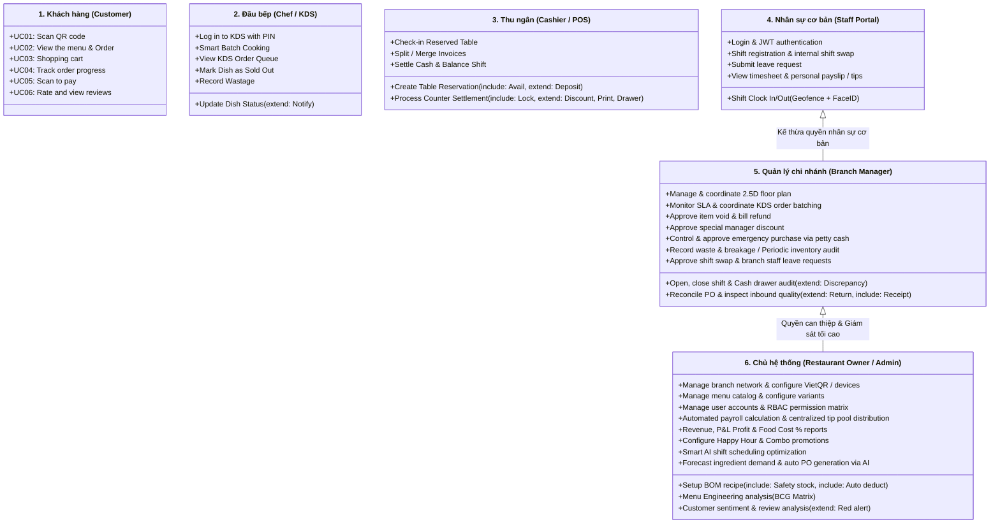

# Thư Viện Tài Liệu Kỹ Thuật — Restaurant OS (Knowledge Hub)

Chào mừng toàn thể đội ngũ phát triển (**Product Owner, BA, Tech Lead, Frontend, Backend, AI Engineer, QA/QC**) đến với Trung tâm tài liệu nghiệp vụ của **Restaurant OS**.

> [!IMPORTANT]
> **QUY CHUẨN ĐIỀU HÀNH BẮT BUỘC & SINGLE SOURCE OF TRUTH (SSOT):**
> 1. Nhóm phát triển đã chính thức thống nhất và ban hành **Bộ Use Cases Toàn Hệ Thống**. Toàn bộ tài liệu nghiệp vụ của dự án hiện nay được tái cấu trúc, lấy **Use Cases làm kim chỉ nam chính thức duy nhất (Single Source of Truth - SSOT)**.
> 2. Mọi quyết định kỹ thuật: Thiết kế bảng PostgreSQL (Flyway), DTO, REST API, WebSocket STOMP Topic, Cây Route Next.js 15, Component và Test Cases **bắt buộc phải truy vết trực tiếp (Traceability) về các Use Case trong tài liệu này**.

---

## 1. Căn Cứ Nghiệp Vụ Chính Thức Duy Nhất Của Dự Án

| Tài liệu | Đường dẫn | Định dạng | Mục đích tra cứu & Áp dụng |
| :--- | :--- | :--- | :--- |
| **Bản Đặc Tả Master Use Cases (Chính thức)** | [Restaurant_OS_Master_UseCases.md](file:///d:/my-project/restaurant-os/doc/Restaurant_OS_Master_UseCases.md) | Markdown | **Tài liệu nghiệp vụ cốt lõi (SSOT):** Đặc tả chi tiết từng Use Case cho cả 6 tác nhân (Pre-conditions, Main Flow, Exceptions, Post-conditions, API & STOMP endpoint). |
| **Báo Cáo Thiết Kế Database (Master DB Report)** | [Restaurant_OS_Database_Design_Report.md](file:///d:/my-project/restaurant-os/doc/Restaurant_OS_Database_Design_Report.md) | Markdown | **Báo cáo kỹ thuật CSDL toàn diện:** Báo cáo chính thức REP-ROS-DB-01, 28 thực thể phân 7 Module, Sơ đồ ERD, Sổ cái kho kép BOM, Trạm KDS và tối ưu hóa hiệu năng PostgreSQL 16. |

*(Lưu ý: Tài liệu sơ đồ hình vẽ draw.io / diagram sẽ được nhóm cập nhật và bổ sung vào thư mục này sau khi hoàn thiện đồ họa).*

---

## 2. Bản Đồ 6 Tác Nhân Nghiệp Vụ Cốt Lõi (Actors Navigation Map)

Toàn bộ nghiệp vụ của Restaurant OS xoay quanh 6 tác nhân chính với các ranh giới và trách nhiệm được phân định rõ ràng:

### Chi tiết phân hệ từng tác nhân:

| Tác nhân (Actor) | Không gian Route Next.js 15 | Các Use Cases cốt lõi | Chi tiết trong Master Spec |
| :--- | :--- | :--- | :--- |
| **1. Khách hàng (Customer)** | `app/(customer)/*` | **UC01:** Scan QR code **UC02:** View the menu & Order **UC03:** Shopping cart (Realtime STOMP) **UC04:** Track order progress **UC05:** Scan to pay (VietQR/MoMo) **UC06:** Rate and view reviews | [Đặc tả Phân hệ Khách hàng](file:///d:/my-project/restaurant-os/doc/Restaurant_OS_Master_UseCases.md#3-dac-ta-chi-tiet-phan-he-khach-hang-customer-mobile-web) |
| **2. Đầu bếp (Chef / KDS)** | `app/(staff)/kds/[stationId]/*` | **UC_CHEF_01:** Log in to KDS with PIN **UC_CHEF_02:** View KDS Order Queue **UC_CHEF_03:** Smart Batch Cooking (gom 5p) **UC_CHEF_04:** Update Dish Status + Notify Waitstaff/Cust **UC_CHEF_05:** Mark Dish as Sold Out **UC_CHEF_06:** Record Wastage | [Đặc tả Phân hệ Đầu bếp KDS](file:///d:/my-project/restaurant-os/doc/Restaurant_OS_Master_UseCases.md#4-dac-ta-chi-tiet-phan-he-dau-bep-kitchen-display-system--kds) |
| **3. Thu ngân (Cashier / POS)** | `app/(staff)/pos/*` | **UC_CASH_01:** Create Table Reservation (Check Avail + Deposit) **UC_CASH_02:** Check-in Reserved Table **UC_CASH_03:** Split / Merge Invoices **UC_CASH_04:** Payment (Lock Table + Discount + ESC/POS + Cash Drawer) **UC_CASH_05:** Settle Cash & Balance Shift | [Đặc tả Phân hệ Thu ngân POS](file:///d:/my-project/restaurant-os/doc/Restaurant_OS_Master_UseCases.md#5-dac-ta-chi-tiet-phan-he-thu-ngan-cashier--pos) |
| **4. Nhân sự cơ bản (Staff)** | `app/(staff-portal)/*` hoặc `app/(me)/*` | **UC_STF_01:** Login & JWT authentication **UC_STF_02:** Shift Clock In/Out (Geofence + FaceID) **UC_STF_03:** Shift registration & swap **UC_STF_04:** Submit leave request **UC_STF_05:** View timesheet & personal payslip/tips | [Đặc tả Phân hệ Cổng Nhân Sự](file:///d:/my-project/restaurant-os/doc/Restaurant_OS_Master_UseCases.md#6-dac-ta-chi-tiet-phan-he-nhan-su-co-ban-staff-portal) |
| **5. Quản lý chi nhánh (Manager)** | `app/(manager)/*` | **UC_MGR_01:** Shift cash drawer audit + Discrepancy statement **UC_MGR_02:** Coordinate 2.5D floor plan **UC_MGR_03:** Monitor SLA & coordinate KDS order batching **UC_MGR_04:** Approve item void & bill refund **UC_MGR_05:** Approve manager discount **UC_MGR_06:** Petty cash emergency purchase **UC_MGR_07:** Reconcile PO + Return note + Stock receipt **UC_MGR_08:** Inventory audit & waste tracking **UC_MGR_09:** Approve shift swap & leave requests | [Đặc tả Phân hệ Quản lý Chi nhánh](file:///d:/my-project/restaurant-os/doc/Restaurant_OS_Master_UseCases.md#7-dac-ta-chi-tiet-phan-he-quan-ly-chi-nhanh-branch-manager) |
| **6. Chủ quán (Owner / Admin)** | `app/(admin)/*` | **UC_OWN_01:** Manage branch network & VietQR **UC_OWN_02:** Menu catalog & JSONB variants **UC_OWN_03:** BOM recipe + Safety stock + Auto deduction **UC_OWN_04:** RBAC permission matrix **UC_OWN_05:** Payroll & Tip pool distribution **UC_OWN_06:** Revenue, P&L & Food Cost % reports **UC_OWN_07:** Menu Engineering (BCG Matrix) **UC_OWN_08:** Happy Hour & Combo promotions **UC_OWN_09:** AI Smart shift scheduling **UC_OWN_10:** Forecast demand & auto PO via AI **UC_OWN_11:** Customer sentiment analysis + Red alert | [Đặc tả Phân hệ Chủ Nhà Hàng](file:///d:/my-project/restaurant-os/doc/Restaurant_OS_Master_UseCases.md#8-dac-ta-chi-tiet-phan-he-chu-he-thong-restaurant-owner--admin) |

---

## 3. Ma Trận Phân Quyền Vai Trò (RBAC Matrix)

| Nhóm chức năng Use Case | Khách hàng | Đầu bếp | Thu ngân | Nhân viên | Quản lý | Chủ quán |
| :--- | :---: | :---: | :---: | :---: | :---: | :---: |
| **Xem Menu & Tự gọi món** | **Tự phục vụ** | Không | Hỗ trợ gọi | Không | Giám sát | Toàn quyền |
| **Giỏ hàng nhóm & Theo dõi đơn** | **Tự phục vụ** | Không | Xem đơn | Không | Giám sát | Toàn quyền |
| **KDS Nấu, Gom món & Báo hết món** | Xem tiến độ | **Toàn quyền** | Xem tiến độ | Không | Giám sát / Điều phối | Toàn quyền |
| **Ghi nhận hao hụt bếp (Wastage)** | Không | **Thực hiện** | Không | Không | **Kiểm kê & Duyệt** | Báo cáo P&L |
| **Đặt bàn, Giữ chỗ & Check-in** | Không | Không | **Toàn quyền** | Không | Điều phối | Toàn quyền |
| **Tách/Gộp bill & Thu ngân tại quầy** | Không | Không | **Toàn quyền** | Không | Đối soát | Toàn quyền |
| **Mở/Đóng két tiền & Chốt ca** | Không | Không | **Khai báo ca** | Không | **Kiểm đếm & Duyệt** | Giám sát dòng tiền |
| **Duyệt Ngoại lệ (Hủy món/Giảm giá)** | Không | Không | Gửi yêu cầu | Không | **Phê duyệt mã PIN** | Toàn quyền |
| **Nhập kho PO & Trả hàng NCC** | Không | Không | Không | Không | **Kiểm định & Nhận** | Tạo PO tự động |
| **Thiết lập Menu, BOM & Trừ kho** | Không | Xem công thức | Không | Không | Xem & Khóa món | **Toàn quyền** |
| **Chấm công, Đổi ca & Nghỉ phép** | Không | Kế thừa Staff | Kế thừa Staff | **Thực hiện** | **Phê duyệt cơ sở** | Tối ưu AI |
| **Báo cáo Tài chính, P&L & Dự báo AI**| Không | Không | Không | Không | Xem chi nhánh | **Toàn hệ thống** |

---

## 4. Quy Chuẩn Kỹ Thuật Bất Biến Dành Cho Lập Trình Viên (Technical Invariants)

1. **Truy vết Use Case (Traceability):** Khi tạo PR hoặc viết mã, phải ghi rõ mã Use Case trong commit message (Ví dụ: `feat(kds): implement smart batch cooking (UC_CHEF_03)`).
2. **Cơ sở dữ liệu (Database Schema):**
   - Flyway trong `backend/src/main/resources/db/migration/` là cơ quan duy nhất quản lý DDL. Nghiêm cấm bật `ddl-auto` của Hibernate.
   - Tiền tệ và doanh thu: Bắt buộc dùng số nguyên VND (`BIGINT` / `INTEGER`). Tuyệt đối không dùng số thực (`FLOAT`, `DOUBLE`).
   - Biến thể món ăn (Size, Topping, Mức đường/đá): Sử dụng kiểu `JSONB` có đánh chỉ mục GIN.
3. **Giao tiếp Realtime WebSocket STOMP:**
   - Topic cấu trúc chuẩn: `/topic/table/{tableId}/cart`, `/topic/kds/{stationId}`, `/topic/tables/{storeId}`.
   - **Luật khôi phục kết nối (Reconnect Sync):** Khi rớt mạng và kết nối lại, client bắt buộc phải gọi REST API đồng bộ trạng thái mới nhất trước khi nhận tin STOMP tiếp theo.
   - **Tính lũy kế (Idempotency):** Mọi request thay đổi trạng thái (đặt món, cập nhật KDS, thanh toán, mở két) bắt buộc gửi kèm UUID `idempotencyKey`.
4. **Quy trình Git & Đóng góp:** Tuân thủ hướng dẫn trong [CONTRIBUTING.md](file:///d:/my-project/restaurant-os/CONTRIBUTING.md).
