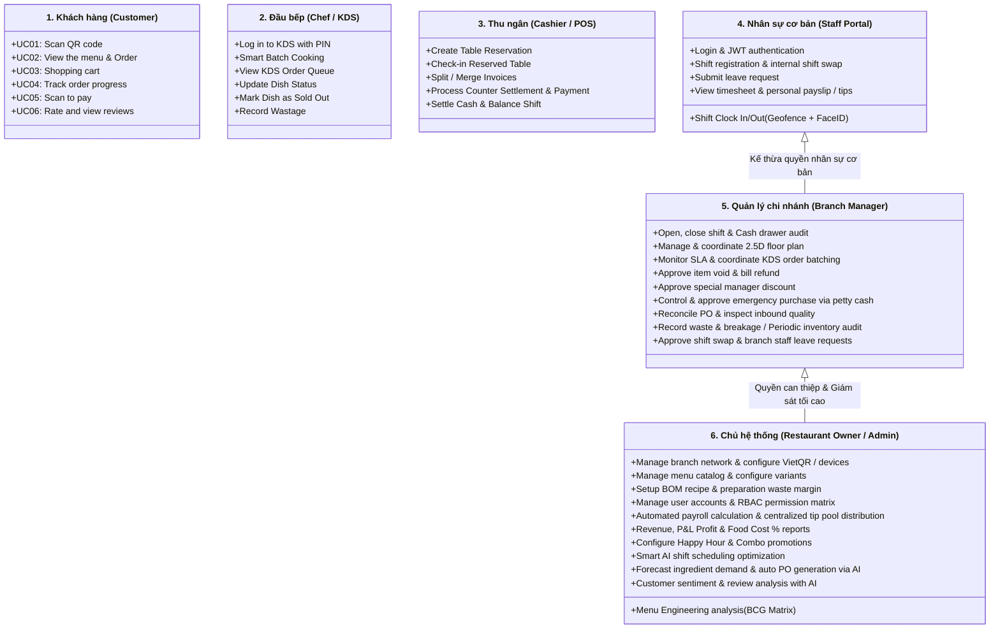

# Đặc Tả Use Cases Hệ Thống — Restaurant OS (Master Specification)
## Tài Liệu Nghiệp Vụ Chính Thức & Chuẩn Mực Phát Triển (Single Source of Truth)

---

### Thông Tin Kiểm Soát Tài Liệu (Document Control)

| Thuộc tính | Chi tiết |
| :--- | :--- |
| **Mã tài liệu** | `SPEC-ROS-USECASE-MASTER-01` |
| **Phiên bản** | `2.0.0` (**Official Team Baseline — Tài liệu kỹ thuật chính thức duy nhất**) |
| **Tình trạng pháp lý** | **ĐÃ PHÊ DUYỆT BỞI TOÀN BỘ DỰ ÁN (Approved by Team)** |
| **Phạm vi áp dụng** | Product Owner, BA, Tech Lead, Frontend, Backend, AI Engineer, QA/QC |
| **Tài liệu căn cứ** | Sơ đồ Use Case nhóm chốt: Customer (Image 1), Chef (Image 2), Cashier (Image 3), [Restaurant_OS_Owner_Manager_UseCases.drawio](file:///d:/my-project/restaurant-os/doc/Restaurant_OS_Owner_Manager_UseCases.drawio) |
| **Ngày hiệu lực** | 2026-11-01 |

> [!IMPORTANT]
> **QUY CHUẨN ĐIỀU HÀNH BẮT BUỘC DÀNH CHO TOÀN BỘ ĐỘI NGŨ DỰ ÁN:**
> 1. Tài liệu này là **Căn cứ nghiệp vụ chính thức duy nhất (Single Source of Truth - SSOT)** của dự án Restaurant OS. Mọi mã nguồn (Backend Entity, REST API, WebSocket STOMP, Frontend Route, Component, Test Cases) đều bắt buộc phải đối chiếu và truy vết trực tiếp về các Use Cases trong tài liệu này.
> 2. Nghiêm cấm tự ý thêm bớt tính năng, trường dữ liệu hoặc thay đổi luồng xử lý mà không có sự đồng thuận cập nhật vào tài liệu Use Case này.

---

## 1. Cấu Trúc Tác Nhân & Phân Tầng Hệ Thống (Actor Hierarchy & System Architecture)

Hệ thống **Restaurant OS** được thiết kế xoay quanh 6 tác nhân chính với các ranh giới nghiệp vụ (System Boundaries) rõ ràng:



---

## 2. Ma Trận Phân Quyền Vai Trò (RBAC Matrix)

| Nhóm nghiệp vụ Use Case | Khách hàng (Customer) | Đầu bếp (Chef) | Thu ngân (Cashier) | Nhân viên (Staff) | Quản lý (Manager) | Chủ quán (Owner) |
| :--- | :---: | :---: | :---: | :---: | :---: | :---: |
| **Quét QR, Xem Menu & Gọi món** | **Tự phục vụ** | Không | Hỗ trợ gọi | Không | Giám sát | Toàn quyền |
| **Giỏ hàng nhóm & Theo dõi đơn** | **Tự phục vụ** | Không | Xem đơn | Không | Giám sát | Toàn quyền |
| **KDS Nấu, Gom món & Báo hết món** | Xem tiến độ | **Toàn quyền** | Xem tiến độ | Không | Giám sát / Điều phối | Toàn quyền |
| **Ghi nhận hao hụt bếp (Wastage)** | Không | **Thực hiện** | Không | Không | **Kiểm kê & Duyệt** | Báo cáo P&L |
| **Đặt bàn, Giữ chỗ & Check-in** | Không | Không | **Toàn quyền** | Không | Điều phối | Toàn quyền |
| **Tách/Gộp bill & Thu ngân tại quầy** | Không | Không | **Toàn quyền** | Không | Đối soát | Toàn quyền |
| **Mở/Đóng két tiền & Chốt ca** | Không | Không | **Khai báo ca** | Không | **Kiểm đếm & Duyệt** | Giám sát dòng tiền |
| **Duyệt Ngoại lệ (Hủy món/Giảm giá)** | Không | Không | Gửi yêu cầu | Không | **Phê duyệt mã PIN** | Toàn quyền |
| **Nhập kho PO & Trả hàng NCC** | Không | Không | Không | Không | **Kiểm định & Nhận** | Tạo PO tự động |
| **Thiết lập Menu, BOM & Trừ kho** | Không | Xem công thức | Không | Không | Xem & Khóa món | **Toàn quyền** |
| **Chấm công, Đổi ca & Nghỉ phép** | Không | Kế thừa Staff | Kế thừa Staff | **Thực hiện** | **Phê duyệt cơ sở** | Tối ưu AI |
| **Báo cáo Tài chính, P&L & Dự báo AI**| Không | Không | Không | Không | Xem chi nhánh | **Toàn hệ thống** |

---

## 3. Đặc Tả Chi Tiết Phân Hệ Khách Hàng (Customer Mobile Web)

Phân hệ dành cho thực khách trải nghiệm tự phục vụ tại bàn qua trình duyệt di động, không cần tải ứng dụng native.

```
Route Group: app/(customer)/*
Giao thức: HTTPS REST API + WebSocket STOMP (/topic/table/{tableId}/cart, /topic/table/{tableId}/orders)
```

### UC01: Scan QR code (Quét mã QR tại bàn)
- **Actor chính:** Khách hàng.
- **Mục tiêu:** Mở ứng dụng gọi món tương ứng với đúng số bàn tại chi nhánh nhà hàng.
- **Pre-conditions:** Khách hàng có điện thoại thông minh kết nối Internet (4G/Wi-Fi); bàn ăn đã được dán mã QR tĩnh hoặc động.
- **Main Flow:**
  1. Khách hàng dùng Camera điện thoại hoặc ứng dụng Zalo/Ngân hàng quét mã QR trên mặt bàn.
  2. Trình duyệt mở đường dẫn `https://restaurant-os.vn/qr/[tableId]`.
  3. Hệ thống gửi yêu cầu xác thực bàn qua `GET /api/v1/tables/{tableId}`.
  4. Hệ thống kiểm tra: Bàn hợp lệ, thuộc chi nhánh đang mở cửa.
  5. Màn hình chào mừng (Welcome Screen) xuất hiện kèm hiệu ứng logo xoay nhẹ 3D tilt theo con quay hồi chuyển điện thoại.
  6. Sau 1.2 giây, hệ thống tự động điều hướng vào thực đơn (`/menu`).
- **Alternative / Exception Flows:**
  - *4a. Bàn không tồn tại hoặc đã bị vô hiệu hóa:* Hệ thống hiển thị thông báo "Bàn không khả dụng. Vui lòng liên hệ nhân viên để được hỗ trợ".
  - *4b. Bàn đang trong trạng thái thanh toán hoặc bảo trì:* Hệ thống thông báo trạng thái hiện tại của bàn.
- **Post-conditions:** Phiên làm việc của bàn (Table Session) được kích hoạt trên thiết bị khách hàng.

---

### UC02: View the menu & Order (Xem thực đơn & Chọn món)
- **Actor chính:** Khách hàng.
- **Mục tiêu:** Duyệt danh mục món ăn trực quan, xem chi tiết biến thể và chọn món muốn gọi.
- **Pre-conditions:** Khách hàng đã hoàn thành `UC01`.
- **Main Flow:**
  1. Khách hàng lướt xem thực đơn theo các danh mục: Khai vị, Món chính, Lẩu/Nướng, Đồ uống, Tráng miệng.
  2. Mỗi thẻ món hiển thị: Hình ảnh sắc nét, tên món, đơn giá niêm yết (số nguyên VND), huy hiệu "Bán chạy" hoặc "Món mới".
  3. Thẻ món hỗ trợ hiệu ứng 3D Tilt tương tác theo cử chỉ vuốt/chạm (giới hạn góc nghiêng nghiêm ngặt $\pm 8^\circ$).
  4. Khách hàng bấm vào món ăn để mở Bottom-sheet chi tiết:
     - Chọn các biến thể `JSONB`: Size (Nhỏ, Vừa, Lớn), Mức đường, Mức đá, Độ cay.
     - Tích chọn Topping ăn kèm (mỗi topping có đơn giá số nguyên VND cộng thêm).
     - Nhập ghi chú đặc biệt cho bếp (Ví dụ: "Không lấy hành lá, ít cay").
  5. Chọn số lượng suất ăn và bấm "Thêm vào giỏ".
- **Alternative / Exception Flows:**
  - *1a. Món ăn đã hết nguyên liệu trong kho:* Thẻ món hiển thị mờ kèm nhãn "Tạm hết món", nút "Thêm vào giỏ" bị khóa (Disabled).
- **Post-conditions:** Món ăn kèm các tùy chọn chi tiết được đẩy vào giỏ hàng (`UC03`).

---

### UC03: Shopping cart (Giỏ hàng nhóm thời gian thực)
- **Actor chính:** Khách hàng (và các bạn cùng bàn).
- **Mục tiêu:** Quản lý danh sách món ăn đã chọn của toàn bàn, cho phép nhiều người cùng bàn tương tác giỏ hàng chung với độ trễ $<50\text{ms}$.
- **Pre-conditions:** Khách hàng đã chọn tối thiểu 01 món từ `UC02`.
- **Main Flow:**
  1. Khách hàng mở trang giỏ hàng (`/cart`).
  2. Màn hình kết nối kênh STOMP `/topic/table/{tableId}/cart`.
  3. Khách hàng thấy danh sách món được nhóm theo người chọn (hiển thị Avatar/Tên người thêm món).
  4. Khách hàng có thể:
     - Tăng hoặc giảm số lượng món.
     - Chỉnh sửa topping / ghi chú.
     - Xóa món khỏi giỏ hàng.
  5. Mọi thao tác cập nhật giỏ hàng từ bất kỳ thiết bị nào tại bàn đều phản hồi tức thời lên tất cả các màn hình còn lại.
  6. Khách hàng kiểm tra tổng tiền tạm tính (số nguyên VND) và nhấn nút "Xác nhận gửi đơn đến bếp".
  7. Ứng dụng sinh chuỗi UUID v4 làm `idempotencyKey` và gửi `POST /api/v1/orders`.
  8. Hệ thống xác nhận đơn thành công, giỏ hàng reset và chuyển sang màn hình theo dõi đơn (`UC04`).
- **Post-conditions:** Đơn hàng được đẩy sang hàng đợi Bếp KDS và Thu ngân POS qua WebSocket.

---

### UC04: Track order progress (Theo dõi tiến độ đơn món)
- **Actor chính:** Khách hàng.
- **Mục tiêu:** Khách hàng biết chính xác trạng thái từng món ăn của bàn mình theo thời gian thực mà không cần vẫy tay hỏi nhân viên.
- **Pre-conditions:** Khách hàng đã gửi đơn hàng thành công từ `UC03`.
- **Main Flow:**
  1. Khách hàng truy cập màn hình `/order-tracking`.
  2. Màn hình subscribe kênh STOMP `/topic/table/{tableId}/orders`.
  3. Hệ thống hiển thị tiến độ từng món qua thanh trạng thái trực quan 3 bước:
     - **Chờ tiếp nhận (Pending):** Bếp đã nhận đơn, chờ xếp vào lượt nấu.
     - **Đang chế biến (Cooking):** Bếp đang nấu món (kèm đồng hồ đếm lùi thời gian dự kiến).
     - **Món đã sẵn sàng (Ready / Completed):** Bếp đã hoàn thành, nhân viên đang mang ra bàn.
  4. Khi đầu bếp hoàn tất món trên KDS, màn hình khách hàng nhận sự kiện STOMP và phát âm thanh chuông nhẹ thông báo món ăn sắp được phục vụ.
- **Post-conditions:** Khách hàng an tâm thưởng thức bữa ăn, giảm thiểu tình trạng giục món.

---

### UC05: Scan to pay (Quét mã thanh toán thông minh)
- **Actor chính:** Khách hàng.
- **Mục tiêu:** Tự thanh toán hóa đơn bàn ăn bằng mã QR chuyển khoản ngân hàng hoặc ví điện tử.
- **Pre-conditions:** Khách hàng dùng bữa xong và yêu cầu thanh toán trên ứng dụng.
- **Main Flow:**
  1. Khách hàng nhấn nút "Thanh toán" trên ứng dụng di động.
  2. Hệ thống tổng hợp toàn bộ các món đã dùng của bàn, tính toán thuế VAT và phí dịch vụ (nếu có).
  3. Khách hàng có thể chọn:
     - Thanh toán trọn gói toàn bàn.
     - Chia tiền thông minh (Split Bill): Chia đều số người hoặc ai trả phần nấy.
  4. Hệ thống sinh mã động **VietQR** (chuẩn NAPAS 247) hoặc MoMo QR chứa số tiền chính xác (số nguyên VND) và nội dung chuyển khoản chuẩn hóa (Ví dụ: `BAN04 TTOAN`).
  5. Khách hàng mở ứng dụng ngân hàng hoặc ví điện tử quét mã QR và xác nhận chuyển khoản.
  6. Ngân hàng gửi Webhook xác nhận thanh toán thành công về Backend.
  7. Hệ thống đẩy tín hiệu STOMP đóng bàn, màn hình khách hàng hiển thị thông báo "Thanh toán thành công! Cảm ơn quý khách" và chuyển tiếp sang `UC06`.
- **Post-conditions:** Bàn ăn được giải phóng trên sơ đồ bàn POS; hóa đơn điện tử được lưu trữ.

---

### UC06: Rate and view reviews (Đánh giá & Xem nhận xét)
- **Actor chính:** Khách hàng.
- **Mục tiêu:** Đánh giá chất lượng món ăn, thái độ phục vụ và xem nhận xét cộng đồng.
- **Pre-conditions:** Khách hàng đã hoàn thành thanh toán `UC05`.
- **Main Flow:**
  1. Màn hình đánh giá hiển thị sau khi thanh toán thành công.
  2. Khách hàng chấm điểm sao (1 đến 5 sao) cho tổng thể trải nghiệm, chất lượng món ăn và tốc độ phục vụ.
  3. Chọn nhanh các nhãn đánh giá (Tags): *Món ăn ngon, Bếp ra món nhanh, Nhân viên thân thiện, Không gian sạch sẽ...*
  4. Nhập nhận xét chi tiết dạng văn bản hoặc đính kèm ảnh chụp món ăn.
  5. Nhấn "Gửi đánh giá".
  6. Khách hàng có thể xem lại các bài đánh giá công khai của những khách hàng khác đã dùng bữa tại quán.
- **Business Rule liên kết AI:**
  - Nếu đánh giá $\le 2$ sao hoặc có chứa từ khóa tiêu cực nghiêm trọng (Ví dụ: "sâu", "dị vật", "thịt sống", "thái độ tệ"), hệ thống kích hoạt vi dịch vụ NLP phân tích cảm xúc và bắn **Cảnh báo Đỏ khẩn cấp** tới điện thoại của Quản lý chi nhánh (`UC40b`).
- **Post-conditions:** Đánh giá được lưu vào cơ sở dữ liệu và chuyển dữ liệu sang phân hệ AI Feedback.

---

## 4. Đặc Tả Chi Tiết Phân Hệ Đầu Bếp (Kitchen Display System — KDS)

Phân hệ màn hình cảm ứng chuyên dụng trong không gian bếp công nghiệp, nền tối `#0B0F14`, nút bấm $\ge 48\text{px}$.

```
Route Group: app/(staff)/kds/[stationId]/*
Giao thức: STOMP (/topic/kds/{stationId}, /topic/kds/alerts) + REST API
```

### UC_CHEF_01: Log in to KDS with PIN (Đăng nhập KDS bằng mã PIN)
- **Actor chính:** Đầu bếp (Chef / KDS Operator).
- **Mục tiêu:** Đăng nhập nhanh vào trạm bếp phụ trách mà không cần nhập bàn phím máy tính phức tạp.
- **Pre-conditions:** Thiết bị KDS được gắn tại trạm bếp (Bếp nóng, Bếp nướng, Quầy Bar, Bếp lạnh).
- **Main Flow:**
  1. Màn hình KDS hiển thị giao diện khóa trạm kèm bàn phím số ảo cảm ứng lớn.
  2. Đầu bếp chạm 4 hoặc 6 số PIN cá nhân được cấp từ `UC31c`.
  3. Hệ thống xác thực mã PIN qua `POST /api/v1/auth/kds-pin`.
  4. Xác thực thành công: KDS tự động nạp danh sách trạm tương ứng (`stationId`) và mở giao diện hàng đợi đơn món.
- **Post-conditions:** Phiên làm việc của đầu bếp được gắn liền với các thao tác xử lý đơn hàng tại trạm đó để phục vụ chấm công và truy vết.

---

### UC_CHEF_02: View KDS Order Queue (Xem hàng đợi đơn món KDS)
- **Actor chính:** Đầu bếp.
- **Mục tiêu:** Nắm bắt toàn bộ các món cần chế biến theo trình tự thời gian và mức độ ưu tiên SLA.
- **Pre-conditions:** Đầu bếp đã đăng nhập KDS.
- **Main Flow:**
  1. Đầu bếp theo dõi hàng đợi được tổ chức thành 3 cột Kanban:
     - **Cột 1 — Chờ nấu (Pending):** Các món mới được gửi từ khách hàng hoặc thu ngân.
     - **Cột 2 — Đang nấu (Cooking):** Các món bếp đã nhận nấu và đang chuẩn bị trên bếp.
     - **Cột 3 — Đã hoàn tất (Completed / Ready):** Các món đã nấu xong, chờ nhân viên mang ra bàn.
  2. Mỗi thẻ đơn hiển thị: Số bàn cực to, tên món, số lượng, ghi chú tùy chọn in đậm màu vàng (Ví dụ: `Không ớt, ít đường`).
  3. Bộ đếm thời gian thực (Stopwatch) chạy từ lúc nhận đơn:
     - Dưới 8 phút: Viền xanh lá (Tiến độ an toàn).
     - 8 – 14 phút: Viền vàng hổ phách (Cảnh báo).
     - Quá 15 phút: Viền đỏ nhấp nháy + chuông báo động (Trễ đơn SLA).
- **Post-conditions:** Đầu bếp kiểm soát được tải công việc và không bị sót đơn.

---

### UC_CHEF_03: Smart Batch Cooking (Gom món nấu thông minh)
- **Actor chính:** Đầu bếp.
- **Mục tiêu:** Tự động gom các đơn gọi món giống nhau từ nhiều bàn trong khoảng thời gian ngắn để nấu chung 1 mẻ, tiết kiệm công suất nhiệt.
- **Pre-conditions:** Có từ 2 bàn trở lên cùng gọi một món trong cửa sổ thời gian 5 phút.
- **Main Flow:**
  1. Thuật toán KDS tự động quét hàng đợi: nếu phát hiện các món có cùng `dishId` và **cùng tùy chọn/ghi chú** trong vòng 5 phút.
  2. KDS tự động nhóm lại thành một dòng gom tổng hợp nổi bật trên đầu hàng đợi:
     - Ví dụ: `Bò lúc lắc x3 (Bàn 02, Bàn 05, Bàn 07)`.
  3. Đầu bếp bấm nút "Nhận nấu cả mẻ":
     - Tất cả các order item thuộc nhóm gom đồng loạt chuyển trạng thái sang `COOKING`.
     - Hệ thống kích hoạt cơ chế trừ kho BOM tự động cho toàn bộ số lượng trong mẻ.
  4. Đầu bếp có thể bấm nút "Tách món" nếu chỉ muốn chế biến trước một phần.
- **Post-conditions:** Giảm 40% số lần nổi lửa chảo bếp trong giờ cao điểm.

---

### UC_CHEF_04: Update Dish Status & Notify (Cập nhật trạng thái món ăn)
- **Actor chính:** Đầu bếp.
- **Quan hệ mở rộng:** $\xrightarrow{\ll extend\gg}$ **Notify Waitstaff and Customers** (Thông báo cho phục vụ và khách hàng).
- **Mục tiêu:** Báo cáo tiến độ chế biến và gửi tín hiệu ra sảnh khi món ăn đã sẵn sàng.
- **Main Flow:**
  1. Khi bắt đầu nấu, đầu bếp chạm nút "Bắt đầu nấu" trên thẻ món $\rightarrow$ Trạng thái chuyển thành `COOKING`.
  2. Khi món chín và bày ra đĩa hoàn tất, đầu bếp chạm nút "Hoàn tất" (vùng cảm ứng lớn $\ge 72\text{px}$) $\rightarrow$ Trạng thái chuyển thành `READY`.
  3. Thẻ món tự động trượt sang Cột 3 (Completed).
  4. Kích hoạt luồng mở rộng `Notify Waitstaff and Customers`:
     - Bắn sự kiện STOMP tới thiết bị của nhân viên bàn (Waiter) kèm âm thanh rung: "Bàn 04: Bò lúc lắc đã nấu xong, vui lòng mang ra bàn!".
     - Bắn sự kiện STOMP tới màn hình khách hàng `UC04`: Cập nhật trạng thái "Món đã sẵn sàng".
- **Post-conditions:** Món ăn được bưng ra phục vụ khách trong trạng thái nóng sốt nhất.

---

### UC_CHEF_05: Mark Dish as Sold Out (Báo hết món tại trạm bếp)
- **Actor chính:** Đầu bếp.
- **Mục tiêu:** Khóa món khẩn cấp trực tiếp từ bếp khi nguyên liệu tươi sống bị hỏng hoặc hết đột xuất.
- **Pre-conditions:** Đầu bếp phát hiện nguyên liệu tại trạm không còn đủ để chế biến tiếp.
- **Main Flow:**
  1. Đầu bếp mở menu phụ trên KDS, chọn mục "Báo hết món".
  2. Chạm vào món ăn tương ứng trong danh sách trạm bếp (Ví dụ: "Cá hồi áp chảo").
  3. Bấm xác nhận "Tạm dừng phục vụ món này".
  4. Hệ thống cập nhật cờ `is_available = false` trong cơ sở dữ liệu.
  5. Hệ thống đẩy ngay lập tức thông điệp WebSocket khóa món trên toàn bộ màn hình thực đơn khách hàng (`UC02`) và màn hình POS Thu ngân.
  6. Khách hàng không thể thêm món này vào giỏ hàng kể từ thời điểm đó.
- **Post-conditions:** Ngăn chặn việc khách hàng gọi các món mà bếp không còn khả năng phục vụ.

---

### UC_CHEF_06: Record Wastage (Ghi nhận hao hụt thực phẩm tại bếp)
- **Actor chính:** Đầu bếp.
- **Mục tiêu:** Ghi nhận sự cố làm cháy, khét, rơi vỡ hoặc nguyên liệu hư hỏng phát sinh trong quá trình nấu nướng.
- **Pre-conditions:** Xảy ra sự cố làm hỏng nguyên liệu hoặc món ăn tại khu vực bếp.
- **Main Flow:**
  1. Đầu bếp chọn biểu tượng "Ghi nhận hỏng/hủy" trên thẻ món hoặc góc màn hình KDS.
  2. Chọn loại sự cố: *Nấu cháy/hỏng, Rơi vỡ, Khách đổi ý trả món sau khi đã chế biến*.
  3. Chọn số lượng suất hoặc nguyên vật liệu bị hỏng.
  4. Bấm "Gửi biên bản sự cố".
  5. Hệ thống đẩy thông báo về Trung tâm phê duyệt ngoại lệ của Quản lý chi nhánh (`UC38` & `UC33a`).
  6. Sau khi Quản lý xác nhận, giá trị món ăn bị hỏng được hạch toán vào chi phí hao hụt bất thường trên báo cáo P&L.
- **Post-conditions:** Minh bạch hóa thất thoát nguyên liệu, đảm bảo số tồn kho thực tế và sổ sách không bị lệch.

---

## 5. Đặc Tả Chi Tiết Phân Hệ Thu Ngân (Cashier / POS)

Phân hệ dành cho nhân viên thu ngân tại quầy tính tiền, quản lý sơ đồ bàn, đặt bàn, chia hóa đơn và thanh toán phần cứng.

```
Route Group: app/(staff)/pos/*
Giao thức: STOMP (/topic/pos, /topic/tables/{storeId}) + REST API + Giao tiếp phần cứng ESC/POS
```

### UC_CASH_01: Create Table Reservation (Tạo đặt bàn trước)
- **Actor chính:** Thu ngân (hoặc Lễ tân / Giám sát sảnh).
- **Quan hệ nghiệp vụ:**
  - $\xrightarrow{\ll include\gg}$ **Check Table Availability** (Kiểm tra tình trạng bàn trống).
  - $\xrightarrow{\ll extend\gg}$ **Collect Booking Deposit** (Thu tiền cọc đặt bàn).
- **Mục tiêu:** Tiếp nhận thông tin đặt bàn trước của khách hàng qua điện thoại hoặc trực tiếp tại quầy.
- **Main Flow:**
  1. Thu ngân bấm nút "Đặt bàn mới" trên màn hình POS.
  2. Nhập thông tin khách: Họ tên, Số điện thoại, Số lượng khách (Người lớn + Trẻ em), Thời gian dự kiến đến (Ngày & Giờ), Ghi chú tiệc (Sinh nhật, phòng VIP, ghế trẻ em).
  3. Hệ thống bắt buộc thực hiện luồng `Check Table Availability`:
     - Kiểm tra sơ đồ bàn 2.5D trong khung giờ yêu cầu $\pm 2$ tiếng.
     - Gợi ý các bàn trống phù hợp với số lượng chỗ ngồi (Ví dụ: Bàn 08 - 6 chỗ).
  4. Thu ngân chọn bàn chỉ định và gán cho đơn đặt bàn.
  5. Nếu đặt tiệc hoặc đặt bàn giờ cao điểm có yêu cầu đặt cọc:
     - Kích hoạt luồng mở rộng `Collect Booking Deposit`: Thu ngân nhập số tiền cọc (VND), sinh mã VietQR nhận cọc hoặc nhận tiền mặt.
     - Hệ thống xuất phiếu thu tiền cọc.
  6. Bấm "Xác nhận đặt bàn". Trạng thái bàn trên sơ đồ chuyển sang màu Tím nhạt ("Đã đặt trước - Reserved").
- **Post-conditions:** Bàn được khóa giữ chỗ trước thời gian khách đến 30 phút.

---

### UC_CASH_02: Check-in Reserved Table (Tiếp nhận & Nhận bàn đã đặt)
- **Actor chính:** Thu ngân.
- **Mục tiêu:** Kích hoạt bàn ăn khi khách đặt trước đến nhà hàng đúng hẹn.
- **Pre-conditions:** Bàn đang ở trạng thái "Đã đặt trước" từ `UC_CASH_01`.
- **Main Flow:**
  1. Khách đến quầy đọc số điện thoại hoặc tên người đặt.
  2. Thu ngân tra cứu danh sách khách đặt trong ngày trên POS.
  3. Chọn đơn đặt bàn tương ứng và bấm "Nhận bàn (Check-in)".
  4. Trạng thái bàn chuyển từ "Reserved" sang "Occupied" (Màu xanh dương).
  5. Nếu đơn đặt bàn có tiền cọc: Hệ thống tự động khấu trừ tiền cọc vào hóa đơn của bàn.
  6. Màn hình in phiếu thông tin bàn kèm mã QR để nhân viên hướng dẫn khách vào bàn ngồi gọi món.
- **Post-conditions:** Bàn sẵn sàng cho khách quét mã QR gọi món hoặc nhân viên phục vụ tại bàn.

---

### UC_CASH_03: Split / Merge Invoices (Tách & Gộp hóa đơn bàn)
- **Actor chính:** Thu ngân.
- **Mục tiêu:** Xử lý linh hoạt các tình huống đi chung bàn nhưng thanh toán riêng hoặc ngồi nhiều bàn muốn gộp chung 1 hóa đơn.
- **Pre-conditions:** Bàn có phát sinh đơn hàng đang phục vụ.
- **Main Flow:**
  - **Tình huống 1 — Tách hóa đơn (Split Invoice):**
    1. Thu ngân chọn bàn cần thanh toán, bấm "Tách hóa đơn".
    2. Chọn phương thức: *Tách theo món chỉ định* hoặc *Chia đều tổng tiền*.
    3. Thu ngân kéo thả từng món ăn vào các Bill con (Bill 1, Bill 2...).
    4. Hệ thống tính thuế và tổng tiền độc lập cho từng hóa đơn con.
  - **Tình huống 2 — Gộp hóa đơn (Merge Invoice):**
    1. Thu ngân chọn 2 hoặc nhiều bàn (Ví dụ: Bàn 03 và Bàn 04 ghép tiệc).
    2. Bấm "Gộp bàn & Gộp hóa đơn".
    3. Toàn bộ các món ăn của các bàn được gom chung vào 1 hóa đơn tổng duy nhất.
- **Post-conditions:** Các hóa đơn mới được sinh ra và sẵn sàng cho bước thanh toán.

---

### UC_CASH_04: Process Counter Settlement & Payment (Xử lý thanh toán tại quầy)
- **Actor chính:** Thu ngân.
- **Quan hệ nghiệp vụ:**
  - $\xrightarrow{\ll include\gg}$ **Lock Table State** (Khóa trạng thái bàn).
  - $\xrightarrow{\ll extend\gg}$ **Apply Discount** (Áp dụng mã giảm giá / Voucher).
  - $\xrightarrow{\ll extend\gg}$ **Print Receipt via ESC/POS** (In hóa đơn nhiệt).
  - $\xrightarrow{\ll extend\gg}$ **Trigger Cash Drawer Opening** (Kích hoạt mở két đựng tiền).
- **Mục tiêu:** Quyết toán toàn bộ chi phí bữa ăn của bàn và thu tiền bằng tiền mặt hoặc thanh toán số.
- **Main Flow:**
  1. Thu ngân chọn bàn yêu cầu thanh toán trên sơ đồ POS.
  2. Bấm nút "Bắt đầu thanh toán" $\rightarrow$ Kích hoạt bắt buộc luồng `Lock Table State`:
     - Bàn bị khóa ngay lập tức trên hệ thống; khách hàng tại bàn không thể gửi thêm bất kỳ món nào nữa.
  3. Kiểm tra danh sách món, đơn giá và số lượng.
  4. Nếu có khuyến mãi $\rightarrow$ Kích hoạt luồng `Apply Discount`:
     - Nhập mã Voucher, giảm giá thành viên VIP hoặc áp dụng chiết khấu đặc biệt (nếu vượt trần thu ngân, hệ thống yêu cầu mã PIN duyệt của Quản lý cơ sở `UC33b`).
  5. Chọn hình thức thanh toán:
     - **Thanh toán chuyển khoản VietQR / Thẻ POS:** Màn hình phụ hướng về phía khách hiển thị mã QR động; khi nhận được Webhook thanh toán thành công, hệ thống xác nhận thanh toán.
     - **Thanh toán Tiền mặt (Cash):**
       - Thu ngân nhập số tiền khách đưa (VND); hệ thống tính số tiền thối lại.
       - Kích hoạt luồng `Trigger Cash Drawer Opening`: POS gửi xung điện qua cổng RJ11 của máy in hóa đơn tự động bật mở ngăn kéo két tiền mặt để thu ngân cất tiền và thối lại cho khách.
  6. Kích hoạt luồng `Print Receipt via ESC/POS`:
     - Máy in nhiệt in hóa đơn thanh toán chi tiết (tên quán, số bàn, danh sách món, thuế VAT, mã tra cứu).
  7. Thu ngân bấm "Hoàn tất thanh toán". Bàn chuyển sang trạng thái "Bàn trống - Available".
- **Post-conditions:** Đơn hàng được đóng; doanh thu được ghi nhận vào sổ quỹ ca làm việc; bàn ăn sẵn sàng đón lượt khách mới.

---

### UC_CASH_05: Settle Cash & Balance Shift (Đối soát tiền mặt & Chốt ca)
- **Actor chính:** Thu ngân.
- **Mục tiêu:** Kiểm kê tiền mặt thực tế trong két cuối ca và bàn giao cho ca tiếp theo hoặc nộp cho Quản lý chi nhánh.
- **Pre-conditions:** Hết ca làm việc của thu ngân; tất cả các bàn trong ca đã được quyết toán.
- **Main Flow:**
  1. Thu ngân mở giao diện `/pos/shift/settle`.
  2. Hệ thống hiển thị tóm tắt doanh số trong ca: Tổng thu tiền mặt, Tổng thu chuyển khoản VietQR, Tiền quỹ đầu ca, Các khoản chi khẩn cấp có phiếu.
  3. Thu ngân đếm tiền mặt thực tế trong két và nhập chi tiết số lượng từng mệnh giá (500k, 200k, 100k, 50k, 20k, 10k...).
  4. Hệ thống so khớp tự động:
     $$\text{Chênh lệch} = \text{Tiền mặt thực tế} - (\text{Tiền quỹ đầu ca} + \text{Thu tiền mặt} - \text{Chi tiền mặt})$$
  5. Nếu có chênh lệch thừa hoặc thiếu: Thu ngân nhập lý do giải trình.
  6. Thu ngân và Quản lý chi nhánh cùng ký xác nhận trên phiếu đối soát ca in từ máy in nhiệt ESC/POS.
- **Post-conditions:** Ca thu ngân được khóa lại; dữ liệu đẩy lên báo cáo đối soát két tiền của Quản lý (`UC26`).

---

## 6. Đặc Tả Chi Tiết Phân Hệ Nhân Sự Cơ Bản (Staff Portal)

Áp dụng cho toàn bộ nhân sự làm việc tại nhà hàng (Phục vụ, Đầu bếp, Thu ngân, Tạp vụ, Quản lý).

```
Route Group: app/(me)/* hoặc app/(staff-portal)/*
Giao thức: HTTPS REST API có xác thực JWT (HttpOnly Cookie)
```

### UC_STF_01: Login & JWT authentication (Đăng nhập & Xác thực JWT)
- **Actor chính:** Nhân sự cơ sở (Staff).
- **Mục tiêu:** Đăng nhập an toàn vào hệ thống với vai trò và quyền hạn được phân định.
- **Main Flow:**
  1. Nhân viên truy cập trang `/login`, nhập Email/Số điện thoại và Mật khẩu.
  2. Hệ thống xác thực thông tin tài khoản và kiểm tra trạng thái hoạt động (`ACTIVE`).
  3. Backend trả về `AccessToken` (JWT 15 phút) và lưu `RefreshToken` trong HttpOnly Cookie (7 ngày).
  4. Token mang các Claims: `userId`, `roles`, `storeId`, `fullName`.
  5. Hệ thống tự động điều hướng người dùng đến đúng giao diện chức năng tương ứng (Chef $\rightarrow$ KDS, Cashier $\rightarrow$ POS, Manager $\rightarrow$ Manager Dashboard).
- **Post-conditions:** Phiên làm việc bảo mật được thiết lập.

---

### UC_STF_02: Shift Clock In/Out (Chấm công Vào/Ra ca thông minh)
- **Actor chính:** Nhân sự cơ sở.
- **Mục tiêu:** Ghi nhận giờ giấc làm việc thực tế, chống chấm công hộ và đi muộn/về sớm.
- **Main Flow:**
  1. Khi đến nhà hàng, nhân viên mở trang `/me/check-in` trên điện thoại hoặc đứng trước máy chấm công quầy.
  2. Hệ thống kiểm tra điều kiện bảo mật:
     - **Rào chắn địa lý (Geofencing):** Tọa độ GPS thiết bị nằm trong bán kính $\le 50\text{m}$ so với chi nhánh; hoặc thiết bị kết nối vào đúng BSSID Wi-Fi nội bộ nhà hàng.
     - **Xác thực sinh trắc học:** Quét khuôn mặt (FaceID) hoặc quét mã QR động xoay vòng trên màn hình quầy POS.
  3. Bấm "Chấm công Vào ca (Check-in)" khi bắt đầu làm việc; hoặc "Chấm công Ra ca (Check-out)" khi hết ca.
  4. Hệ thống ghi nhận timestamp chính xác đến giây vào bảng `timecards`.
- **Post-conditions:** Dữ liệu giờ công được ghi nhận phục vụ tính lương tự động (`UC32`).

---

### UC_STF_03: Shift registration & internal shift swap (Đăng ký ca & Đổi ca nội bộ)
- **Actor chính:** Nhân sự cơ sở.
- **Mục tiêu:** Đăng ký nguyện vọng làm việc và đổi ca linh hoạt giữa các đồng nghiệp cùng vị trí.
- **Main Flow:**
  1. Nhân viên xem lịch làm việc dự kiến tuần tới tại `/me/schedule`.
  2. Đăng ký các ca làm việc mong muốn (Ca sáng, Ca chiều, Ca gãy).
  3. Trong trường hợp bận việc đột xuất: Nhân viên chọn ca của mình và gửi yêu cầu "Đổi ca / Nhờ làm thay" tới đồng nghiệp cụ thể.
  4. Đồng nghiệp nhận thông báo trên điện thoại và bấm "Đồng ý nhận ca".
  5. Yêu cầu đổi ca tự động chuyển sang Trung tâm phê duyệt của Quản lý chi nhánh (`UC_MGR_09`).
- **Post-conditions:** Lịch làm việc được cập nhật minh bạch sau khi Quản lý duyệt.

---

### UC_STF_04: Submit leave request (Gửi đơn xin nghỉ phép)
- **Actor chính:** Nhân sự cơ sở.
- **Mục tiêu:** Nộp đơn xin nghỉ phép đúng quy trình trước khi xếp lịch làm việc.
- **Main Flow:**
  1. Nhân viên mở `/me/leave`, chọn "Tạo đơn xin nghỉ".
  2. Chọn loại nghỉ phép: *Nghỉ phép năm, Nghỉ ốm (kèm ảnh chụp giấy khám bệnh), Nghỉ việc riêng không lương*.
  3. Chọn khoảng thời gian nghỉ (từ ngày... đến ngày...).
  4. Nhập lý do chi tiết và nhấn "Gửi đơn".
  5. Đơn nghỉ phép được chuyển đến Quản lý chi nhánh xét duyệt.
- **Post-conditions:** Hệ thống tự động loại trừ nhân viên khỏi các ca làm việc trong khoảng thời gian được duyệt nghỉ.

---

### UC_STF_05: View timesheet & personal payslip / tips (Tra cứu công, lương & tip)
- **Actor chính:** Nhân sự cơ sở.
- **Mục tiêu:** Minh bạch hóa thu nhập cá nhân hàng ngày và hàng tháng.
- **Main Flow:**
  1. Nhân viên truy cập `/me/payslip`.
  2. Xem bảng tổng hợp giờ công thực tế trong tháng: Số giờ chuẩn, Số giờ tăng ca (OT), Số lần đi muộn.
  3. Xem tiền Tip cá nhân được phân bổ theo ngày từ Quỹ Tip tập trung của chi nhánh.
  4. Xem chi tiết phiếu lương hàng tháng: Lương cơ bản, Thưởng doanh số, Tiền Tip, Các khoản giảm trừ bảo hiểm/phạt.
- **Post-conditions:** Nhân viên nắm rõ quyền lợi tài chính, gia tăng gắn kết với nhà hàng.

---

## 7. Đặc Tả Chi Tiết Phân Hệ Quản Lý Chi Nhánh (Branch Manager)

Phân hệ dành cho Trưởng ca và Quản lý cơ sở, chịu trách nhiệm trực tiếp về vận hành sàn, kiểm soát kho và tiền két.

```
Route Group: app/(staff)/manager/* hoặc app/(manager)/*
Giao diện: Tablet chuyên dụng, POS Desktop, Mobile Web quản lý
```

### UC_MGR_01: Open, close shift & Cash drawer audit (Mở, đóng ca & Kiểm kê két tiền)
- **Actor chính:** Quản lý chi nhánh.
- **Quan hệ mở rộng:** $\xleftarrow{\ll extend\gg}$ **File discrepancy statement for cash drawer** (Lập biên bản xử lý chênh lệch tiền két).
- **Mục tiêu:** Đảm bảo tiền mặt tại quầy khớp 100% giữa thực tế và phần mềm, chống thất thoát.
- **Main Flow:**
  1. **Đầu ca:** Quản lý cùng Thu ngân đếm tiền quỹ đầu ca (tiền thối), nhập số tiền vào `/manager/shifts/open` và bấm "Niêm phong két".
  2. **Trong ca:** Hệ thống tự động ghi nhận mọi dòng tiền vào/ra có dấu vết kiểm toán (Audit Trail).
  3. **Cuối ca:** Quản lý nhận bàn giao từ Thu ngân (`UC_CASH_05`), cùng kiểm đếm số tiền mặt thực tế và nhập vào hệ thống.
  4. Nếu số tiền thực tế lệch so với phần mềm tính toán $\rightarrow$ Kích hoạt luồng `File discrepancy statement`:
     - Bắt buộc nhập biên bản giải trình: Nguyên nhân lệch (thối nhầm, thu thiếu, khách nợ), tên người chịu trách nhiệm và phương án xử lý (trừ lương hoặc xuất quỹ bù).
  5. Quản lý duyệt đóng ca và ký biên bản điện tử.
- **Post-conditions:** Ca làm việc bị đóng băng; dữ liệu đẩy lên báo cáo P&L của Chủ nhà hàng.

---

### UC_MGR_02: Manage & coordinate 2.5D floor plan (Quản lý & Điều phối sơ đồ bàn 2.5D)
- **Actor chính:** Quản lý chi nhánh.
- **Mục tiêu:** Cấu hình không gian bàn ăn trực quan và điều phối chỗ ngồi giờ cao điểm.
- **Main Flow:**
  1. Quản lý mở `/manager/floorplan`.
  2. Thiết kế layout nhà hàng: Kéo thả các bàn theo khu vực (Tầng 1, Tầng 2, Sân vườn, Phòng VIP).
  3. Thiết lập thông số bàn: Mã bàn, số ghế tối đa, hình dáng bàn (Tròn, Chữ nhật).
  4. Điều phối trạng thái bàn thời gian thực: Chuyển bàn theo yêu cầu của khách, Ghép các bàn tiệc đông người, Giải phóng bàn ăn bị kẹt trạng thái.
- **Post-conditions:** Sơ đồ bàn đồng bộ tức thì tới tất cả thiết bị POS và thiết bị phục vụ sảnh.

---

### UC_MGR_03: Monitor SLA & coordinate KDS order batching (Giám sát SLA & Điều phối bếp KDS)
- **Actor chính:** Quản lý chi nhánh.
- **Mục tiêu:** Phát hiện tắc nghẽn chế biến tại bếp để can thiệp kịp thời trước khi khách phàn nàn.
- **Main Flow:**
  1. Quản lý truy cập `/manager/kds-monitor` hiển thị đồng hồ đếm thời gian nấu thực tế của từng bàn.
  2. Theo dõi các mức cảnh báo SLA: Xanh ($\le 8$ phút), Vàng ($8 - 14$ phút), Đỏ ($\ge 15$ phút).
  3. Khi phát hiện bàn chờ món quá lâu: Quản lý trực tiếp xuống bếp điều phối ưu tiên nấu trước hoặc điều chuyển nhân lực hỗ trợ quầy nấu.
  4. Can thiệp gom đơn thủ công nếu thuật toán tự động chưa tối ưu hết công suất trạm.
- **Post-conditions:** Đảm bảo thời gian ra món trung bình toàn ca đạt chuẩn SLA cam kết.

---

### UC_MGR_04: Approve item void & bill refund (Phê duyệt hủy món & Hoàn tiền hóa đơn)
- **Actor chính:** Quản lý chi nhánh.
- **Mục tiêu:** Kiểm soát chặt chẽ các ngoại lệ hủy món sau khi bếp đã nấu hoặc hoàn tiền hóa đơn đã đóng.
- **Main Flow:**
  1. Thu ngân hoặc Bồi bàn gửi yêu cầu hủy món đã nấu kèm lý do (Món có dị vật, Khách hủy đột xuất, Bếp nấu nhầm bàn).
  2. Điện thoại/Tablet của Quản lý nhận thông báo đẩy khẩn cấp tại `/manager/approvals`.
  3. Quản lý đến tận nơi kiểm tra thực tế, quẹt thẻ hoặc nhập mã PIN Quản lý 6 số để phê duyệt trên POS.
  4. Nếu chấp thuận:
     - Hệ thống ghi vết vào `audit_logs` (Lưu rõ: ID người yêu cầu, ID người duyệt, Lý do, Timestamp).
     - Bắn tín hiệu STOMP cập nhật hóa đơn bàn và thông báo đến KDS dừng làm món.
     - Hệ thống hạch toán nguyên vật liệu bị hủy vào kho hao hụt (`UC_MGR_08`).
  5. Nếu từ chối: Đơn hàng giữ nguyên trạng thái; gửi lý do từ chối về nhân viên gửi yêu cầu.
- **Post-conditions:** Ngăn chặn gian lận tự ý hủy món để biển thủ tiền mặt.

---

### UC_MGR_05: Approve special manager discount (Phê duyệt chiết khấu đặc biệt của quản lý)
- **Actor chính:** Quản lý chi nhánh.
- **Mục tiêu:** Phê duyệt các mức giảm giá ngoại giao hoặc xử lý sự cố đền bù cho khách hàng vượt trần quyền hạn của thu ngân.
- **Main Flow:**
  1. Thu ngân gửi yêu cầu giảm giá đặc biệt (Ví dụ: Giảm $20\%$ do phục vụ chậm hoặc Khách VIP của chủ quán).
  2. Quản lý nhận thông báo xét duyệt trên ứng dụng quản lý.
  3. Quản lý kiểm tra điều kiện áp dụng, nhập mã PIN phê duyệt và chọn tài khoản ngân sách chiết khấu.
  4. Hóa đơn bàn được cập nhật mức giảm giá mới.
- **Post-conditions:** Toàn bộ lịch sử duyệt chiết khấu được tổng hợp vào báo cáo kiểm toán doanh thu cuối tháng.

---

### UC_MGR_06: Control & approve emergency purchase via petty cash (Chi tiêu khẩn cấp bằng tiền két)
- **Actor chính:** Quản lý chi nhánh.
- **Mục tiêu:** Phê duyệt xuất tiền mặt từ két quầy để mua gấp nguyên liệu lẻ ngoài chợ khi kho hết đột xuất.
- **Main Flow:**
  1. Bếp trưởng báo hết gấp đá lạnh, rau thơm hoặc gia vị trong giờ cao điểm.
  2. Quản lý tạo phiếu xuất quỹ khẩn cấp trên hệ thống `/manager/petty-cash`.
  3. Nhập số tiền tạm ứng (VND), người đi mua và mục đích chi.
  4. Quản lý duyệt xuất tiền mặt từ két thu ngân.
  5. Sau khi mua về: Quản lý chụp ảnh hóa đơn bán lẻ đính kèm và nhập số tiền thực chi để hoàn ứng phần dư vào két.
- **Post-conditions:** Khoản chi được hạch toán minh bạch vào chi phí ca, đảm bảo khi chốt ca tiền két không bị lệch.

---

### UC_MGR_07: Reconcile PO & inspect inbound quality (Đối soát PO & Kiểm định nhập kho)
- **Actor chính:** Quản lý chi nhánh.
- **Quan hệ nghiệp vụ:**
  - $\xrightarrow{\ll include\gg}$ **Officially approve stock receipt & increase inventory** (Ký duyệt nhập kho chính thức & Tăng tồn kho).
  - $\xleftarrow{\ll extend\gg}$ **Issue goods return note & offset vendor debt** (Lập biên bản trả hàng & Cấn trừ công nợ NCC).
- **Mục tiêu:** Tiếp nhận nguyên vật liệu từ nhà cung cấp đúng số lượng và tiêu chuẩn vệ sinh an toàn thực phẩm.
- **Main Flow:**
  1. Nhà cung cấp giao hàng đến cửa kho nhà hàng kèm phiếu giao hàng.
  2. Quản lý mở `/manager/inventory/receipts`, chọn mã đơn hàng PO tương ứng (tạo từ `UC_OWN_10`).
  3. Tiến hành cân đếm thực tế và kiểm tra chất lượng cảm quan (độ tươi sống, hạn sử dụng, bao bì).
  4. Nếu hàng đạt chuẩn:
     - Kích hoạt bắt buộc luồng `Officially approve stock receipt`: Quản lý ký nhận điện tử; hệ thống tự động cộng dồn số lượng vào bảng `inventory_items` tại chi nhánh.
  5. Nếu phát hiện hàng dập nát, thiếu cân hoặc không đúng quy cách:
     - Kích hoạt luồng `Issue goods return note`: Nhập khối lượng hàng từ chối nhận, chụp ảnh bằng chứng và lập biên bản trả hàng ngay tại cửa kho để cấn trừ vào công nợ nhà cung cấp.
- **Post-conditions:** Số tồn kho chi nhánh tăng chính xác; các món ăn từng bị khóa do hết hàng tự động mở bán lại trên menu khách hàng.

---

### UC_MGR_08: Record waste & breakage / Periodic inventory audit (Kiểm kê kho & Hao hụt)
- **Actor chính:** Quản lý chi nhánh.
- **Mục tiêu:** Thực hiện kiểm kê thực tế định kỳ và xử lý các chênh lệch giữa tồn kho thực tế và sổ sách.
- **Main Flow:**
  1. Định kỳ cuối ngày hoặc cuối tuần, Quản lý cùng Bếp trưởng tiến hành cân kiểm kê các nguyên liệu trọng yếu (Thịt, hải sản, rượu, bia).
  2. Nhập khối lượng thực tế cân được vào `/manager/inventory/audit`.
  3. Hệ thống tự động so sánh với số tồn kho lý thuyết (sau khi đã trừ kho tự động theo BOM qua `UC_OWN_03`):
     $$\text{Chênh lệch tồn} = \text{Tồn thực tế kiểm kê} - \text{Tồn lý thuyết phần mềm}$$
  4. Nếu hao hụt nằm trong biên độ cho phép: Hệ thống cập nhật số dư tồn kho mới.
  5. Nếu hao hụt bất thường vượt ngưỡng $2\%$: Quản lý bắt buộc lập biên bản điều tra nguyên nhân (thất thoát, hỏng hóc, định lượng làm sai).
- **Post-conditions:** Dữ liệu tồn kho được làm sạch, phục vụ chính xác cho thuật toán dự báo AI.

---

### UC_MGR_09: Approve shift swap & branch staff leave requests (Duyệt đổi ca & Nghỉ phép)
- **Actor chính:** Quản lý chi nhánh.
- **Mục tiêu:** Phê duyệt đơn xin nghỉ phép và yêu cầu đổi ca của nhân viên chi nhánh, đảm bảo luôn đủ người phục vụ sàn.
- **Main Flow:**
  1. Quản lý nhận thông báo có đơn xin nghỉ phép (`UC_STF_04`) hoặc đơn đổi ca (`UC_STF_03`) tại `/manager/staff-approvals`.
  2. Kiểm tra định mức nhân sự tối thiểu của ca làm việc đó (Đủ bồi bàn, đủ đầu bếp, đủ thu ngân).
  3. Nhấn "Chấp thuận" hoặc "Từ chối" (kèm lý do).
  4. Lịch làm việc tuần tự động cập nhật và gửi thông báo phản hồi về điện thoại của nhân viên.
- **Post-conditions:** Đảm bảo vận hành sàn thông suốt, không bị thiếu hụt nhân sự giờ cao điểm.

---

## 8. Đặc Tả Chi Tiết Phân Hệ Chủ Hệ Thống (Restaurant Owner / Admin)

Phân hệ dành cho Chủ nhà hàng và Ban điều hành, tập trung vào chiến lược chuỗi, công thức BOM, tài chính P&L và trí tuệ nhân tạo AI.

```
Route Group: app/(admin)/*
Giao diện: Desktop Web, iPad Pro, Mobile Dashboard
```

### UC_OWN_01: Manage branch network & configure VietQR / devices (Quản lý mạng lưới chi nhánh)
- **Actor chính:** Chủ hệ thống / Admin.
- **Mục tiêu:** Khởi tạo và quản trị tập trung nhiều nhà hàng trong chuỗi F&B.
- **Main Flow:**
  1. Chủ quán vào `/admin/branches`, xem danh sách toàn bộ cơ sở cùng trạng thái hoạt động và doanh thu thời gian thực.
  2. Tạo chi nhánh mới: Nhập Tên cơ sở, Địa chỉ, Tọa độ GPS (phục vụ Geofencing chấm công), Số lượng bàn tối đa.
  3. Cấu hình thông số thanh toán độc lập: Số tài khoản ngân hàng thụ hưởng VietQR của từng chi nhánh, cấu hình máy in hóa đơn ESC/POS mạng LAN.
  4. Hệ thống khởi tạo kho dữ liệu độc lập (`store_id`) và mã kích hoạt trạm POS cơ sở.
- **Post-conditions:** Chi nhánh mới sẵn sàng đi vào vận hành.

---

### UC_OWN_02: Manage menu catalog & configure variants (Quản trị thực đơn & Biến thể JSONB)
- **Actor chính:** Chủ hệ thống / Admin.
- **Mục tiêu:** Thiết lập danh mục thực đơn linh hoạt áp dụng chung cho toàn chuỗi hoặc tùy biến theo cơ sở.
- **Main Flow:**
  1. Chủ quán truy cập `/admin/menu`, chọn tạo món mới hoặc chỉnh sửa món ăn hiện có.
  2. Khai báo thông tin chuẩn: Tên món, Phân loại danh mục, Đơn giá niêm yết (số nguyên VND), Ảnh WebP tối ưu.
  3. Cấu hình cấu trúc biến thể động lưu dạng `JSONB` trong PostgreSQL:
     - Nhóm Option: Kích cỡ (Size S/M/L), Mức ngọt, Mức đá, Độ cay.
     - Danh sách Topping ăn kèm (mỗi topping có đơn giá số nguyên VND).
  4. Thiết lập tính khả dụng của món ăn theo từng chi nhánh cụ thể.
- **Post-conditions:** Thực đơn mới lập tức xuất hiện trên ứng dụng gọi món của khách hàng qua WebSocket STOMP.

---

### UC_OWN_03: Setup BOM recipe & preparation waste margin (Thiết lập công thức BOM)
- **Actor chính:** Chủ hệ thống / Admin.
- **Quan hệ nghiệp vụ:**
  - $\xrightarrow{\ll include\gg}$ **Configure safety stock threshold & auto stockout lock** (Cấu hình ngưỡng an toàn & Khóa món).
  - $\xrightarrow{\ll include\gg}$ **Auto deduct inventory via BOM when Kitchen starts cooking** (Tự động trừ kho theo BOM).
- **Mục tiêu:** Định lượng nguyên vật liệu chính xác cho từng món ăn để tự động hóa quản lý kho.
- **Main Flow:**
  1. Chủ quán vào `/admin/bom`, chọn món ăn cần thiết lập công thức.
  2. Khai báo danh sách nguyên vật liệu cấu thành từ bảng `inventory_items`:
     - Định lượng chuẩn trên một suất ăn: Đơn vị tính (`g`, `ml`, `unit`).
     - Tỷ lệ hao hụt sơ chế (Wastage Rate, ví dụ: Rửa/thái thịt hao $5\%$).
  3. Kích hoạt luồng bắt buộc `Configure safety stock threshold & auto stockout lock`:
     - Khai báo ngưỡng tồn kho an toàn tối thiểu (Safe Stock Threshold).
     - Khi tồn kho rơi xuống dưới ngưỡng: Bắn cảnh báo nhập hàng.
     - Khi tồn kho $= 0$: Hệ thống tự động kích hoạt cờ `is_available = false` khóa món trên toàn mạng lưới.
  4. Khi vận hành trên thực tế, hệ thống kích hoạt luồng `Auto deduct inventory via BOM`:
     - Ngay khi Bếp bấm nhận nấu (`COOKING` tại `UC_CHEF_04`), Spring Boot mở `@Transactional` trừ trực tiếp số dư kho:
       $$\text{Lượng trừ kho} = \text{Định lượng chuẩn} \times (1 + \text{Tỷ lệ hao hụt}) \times \text{Số lượng suất}$$
- **Post-conditions:** Đảm bảo số liệu tồn kho luôn khớp với thực tế từng gram theo thời gian thực ($<50\text{ms}$).

---

### UC_OWN_04: Manage user accounts & RBAC permission matrix (Phân quyền RBAC)
- **Actor chính:** Chủ hệ thống / Admin.
- **Mục tiêu:** Kiểm soát chặt chẽ quyền truy cập, ngăn ngừa gian lận tài chính và rò rỉ dữ liệu chuỗi.
- **Main Flow:**
  1. Chủ quán mở `/admin/users`, chọn tạo tài khoản hoặc chỉnh sửa phân quyền nhân sự.
  2. Gán Role: `ROLE_OWNER`, `ROLE_MANAGER`, `ROLE_CASHIER`, `ROLE_CHEF`, `ROLE_WAITER`.
  3. Cấp phát mã định danh POS và sinh mã PIN 4-6 số phục vụ xác thực nhanh khi đứng tại quầy POS hoặc trạm KDS.
  4. Cấu hình quyền hạn trần: Hạn mức chiết khấu tối đa (% được duyệt), Quyền xem doanh thu chi nhánh.
- **Post-conditions:** Quyền hạn mới áp dụng ngay lập tức cho các phiên đăng nhập tiếp theo.

---

### UC_OWN_05: Automated payroll calculation & tip pool distribution (Tính lương & Chia tip)
- **Actor chính:** Chủ hệ thống / Admin.
- **Mục tiêu:** Tự động hóa tính toán lương thưởng theo giờ công thực tế và phân bổ quỹ Tip minh bạch.
- **Main Flow:**
  1. Chủ quán vào `/admin/payroll`, chọn kỳ thanh toán lương (Tuần/Tháng).
  2. Hệ thống tự động tổng hợp dữ liệu chấm công từ `UC_STF_02`: Tổng số giờ làm việc thực tế, Số ca lễ, Số giờ tăng ca OT.
  3. Tổng hợp Quỹ Tip tập trung thu được từ các hóa đơn khách hàng thanh toán qua VietQR/MoMo:
     - Tự động phân bổ đều theo tỷ lệ số giờ làm việc thực tế của từng nhân viên trong kỳ.
  4. Chủ quán kiểm tra bảng tổng hợp, nhấn "Phê duyệt bảng lương".
  5. Hệ thống xuất phiếu lương chi tiết tới Cổng nhân viên (`UC_STF_05`).
- **Post-conditions:** Giảm 90% thời gian tính lương thủ công của phòng kế toán.

---

### UC_OWN_06: Revenue, P&L Profit & Food Cost % reports (Báo cáo Doanh thu & Lãi lỗ P&L)
- **Actor chính:** Chủ hệ thống / Admin.
- **Mục tiêu:** Nắm bắt bức tranh tài chính toàn diện thời gian thực của toàn bộ hệ thống chuỗi nhà hàng.
- **Main Flow:**
  1. Chủ quán mở `/admin/finance`.
  2. Hệ thống hiển thị Dashboard tài chính thời gian thực:
     - **Doanh thu gộp (Gross Revenue):** Tổng giá trị đơn hàng hoàn tất (VND).
     - **Giá vốn hàng bán (COGS / Food Cost %):** Chi phí nguyên liệu tiêu hao tính theo BOM và hao hụt thực tế.
     - **Lợi nhuận gộp (Gross Profit):** $\text{Doanh thu} - \text{COGS}$.
     - **Tỷ lệ hủy món (Void/Loss Ratio):** Thất thoát do hủy món sau chế biến.
  3. Bộ lọc đa chiều: Lọc theo từng chi nhánh, so sánh tăng trưởng cùng kỳ (MoM, YoY).
  4. Xuất báo cáo định dạng Excel/PDF chuẩn mực kế toán quản trị.
- **Post-conditions:** Cung cấp số liệu chính xác phục vụ ra quyết định kinh doanh.

---

### UC_OWN_07: Menu Engineering analysis (Phân tích ma trận thực đơn BCG)
- **Actor chính:** Chủ hệ thống / Admin.
- **Mục tiêu:** Tối ưu hóa thực đơn dựa trên phân tích mức độ sinh lời và mức độ ưa chuộng của từng món ăn.
- **Main Flow:**
  1. Chủ quán truy cập `/admin/menu-engineering`.
  2. Thuật toán tự động phân loại toàn bộ món ăn trong thực đơn vào ma trận 4 góc phần tư BCG:
     - **Ngôi sao (Stars):** Lãi cao + Bán chạy $\rightarrow$ Giữ nguyên chất lượng và vị trí hiển thị ưu tiên trên menu.
     - **Bò sữa (Cash Cows):** Lãi thấp + Bán chạy $\rightarrow$ Tăng nhẹ giá bán hoặc tối ưu hóa công thức BOM để giảm Food Cost.
     - **Dấu hỏi (Puzzles):** Lãi cao + Bán chậm $\rightarrow$ Đẩy mạnh quảng bá, đưa vào combo khuyến mãi hoặc đổi hình ảnh thẻ món 3D tilt.
     - **Chó mực (Dogs):** Lãi thấp + Bán chậm $\rightarrow$ Cân nhắc loại bỏ khỏi thực đơn để giải phóng tồn kho.
  3. Chủ quán bấm áp dụng các đề xuất tối ưu giá bán trực tiếp từ màn hình phân tích.
- **Post-conditions:** Tăng biên lợi nhuận ròng của thực đơn từ $3 - 5\%$.

---

### UC_OWN_08: Configure Happy Hour & Combo promotions (Cấu hình khuyến mãi & Combo)
- **Actor chính:** Chủ hệ thống / Admin.
- **Mục tiêu:** Thiết lập các chiến dịch kích cầu tự động linh hoạt theo khung giờ và giá trị giỏ hàng.
- **Main Flow:**
  1. Chủ quán mở `/admin/promotions`, chọn "Tạo chương trình khuyến mãi mới".
  2. Chọn loại hình chiến dịch:
     - **Khung giờ vàng (Happy Hour):** Giảm giá % tự động cho đồ uống/khai vị trong khung giờ thấp điểm (Ví dụ: 14h - 17h thứ 2 đến thứ 5).
     - **Combo món ăn:** Mua món A tặng món B hoặc giảm giá khi gọi kèm Combo gia đình.
     - **Chiết khấu giỏ hàng:** Giảm trực tiếp VND cho hóa đơn đạt giá trị nhất định.
  3. Thiết lập điều kiện: Chi nhánh áp dụng, Ngân sách khuyến mãi trần tối đa.
  4. Bấm "Kích hoạt chiến dịch".
- **Post-conditions:** Khuyến mãi tự động kích hoạt trên ứng dụng khách hàng và POS thu ngân đúng khung giờ mà không cần can thiệp mã nguồn.

---

### UC_OWN_09: Smart AI shift scheduling optimization (Tối ưu lịch phân ca bằng AI)
- **Actor chính:** Chủ hệ thống / Admin.
- **Mục tiêu:** Tự động xếp lịch làm việc tối ưu chi phí nhân sự nhưng vẫn đảm bảo chất lượng phục vụ giờ cao điểm.
- **Main Flow:**
  1. Chủ quán chọn tuần làm việc cần xếp lịch tại `/admin/ai/scheduling`.
  2. Bấm "Chạy thuật toán tối ưu AI". Hệ thống xử lý đồng thời 3 luồng dữ liệu:
     - Dự báo lượng khách giờ cao điểm từ `UC_OWN_10`.
     - Định mức nhân sự tối thiểu theo quy định từng vị trí (Sảnh, Bếp, Thu ngân).
     - Đơn đăng ký ca và nguyện vọng nghỉ của nhân sự từ `UC_STF_03` và `UC_STF_04`.
  3. Thuật toán AI sinh ra bảng lịch phân ca tối ưu chi phí nhân sự.
  4. Chủ quán rà soát, tinh chỉnh thủ công nếu cần và bấm "Ban hành lịch làm việc tuần".
- **Post-conditions:** Lịch làm việc được phát hành tự động tới điện thoại của toàn bộ nhân viên.

---

### UC_OWN_10: Forecast ingredient demand & auto PO generation via AI (Dự báo nhu cầu AI & Tự động tạo PO)
- **Actor chính:** Chủ hệ thống / Admin.
- **Mục tiêu:** Dự báo chính xác lượng nguyên vật liệu cần dùng cho 7 ngày tới và tự động tạo đơn mua hàng nhà cung cấp (PO).
- **Pre-conditions:** Hệ thống có dữ liệu bán hàng tối thiểu 30 ngày.
- **Main Flow:**
  1. Microservice AI phân tích đa biến số: Lịch sử tiêu thụ từng món ăn + Xu hướng thời tiết + Lịch sự kiện/ngày lễ cuối tuần.
  2. Hệ thống hiển thị bảng dự báo nhu cầu chi tiết: Khối lượng từng nguyên liệu cần dùng, Tồn kho thực tế hiện tại, và Khối lượng cần nhập thêm (Reorder Quantity).
  3. Hệ thống tự động gom đơn theo từng Nhà cung cấp và sinh các phiếu Đặt hàng dự trù (Purchase Order - PO).
  4. Chủ quán rà soát đơn giá và số lượng, bấm "Duyệt đơn PO".
  5. Hệ thống gửi email tự động đơn PO đến nhà cung cấp.
- **Post-conditions:** Phiếu PO chuyển sang trạng thái chờ Quản lý chi nhánh tiếp nhận tại kho (`UC_MGR_07`).

---

### UC_OWN_11: Customer sentiment & review analysis with AI (Phân tích cảm xúc & Nhận xét AI)
- **Actor chính:** Chủ hệ thống / Admin.
- **Quan hệ mở rộng:** $\xleftarrow{\ll extend\gg}$ **Instant red alert for negative feedback to manager** (Cảnh báo đỏ phản hồi tiêu cực khẩn cấp).
- **Mục tiêu:** Lắng nghe và phân loại tự động toàn bộ phản hồi của khách hàng sau bữa ăn để cải thiện chất lượng dịch vụ.
- **Main Flow:**
  1. Chủ quán mở `/admin/ai/feedback`.
  2. Mô hình NLP tiếng Việt tự động thu thập và phân tích các đánh giá từ `UC06`:
     - Phân loại cảm xúc: Tích cực, Trung tính, Tiêu cực.
     - Trích xuất chủ đề: *Món ăn nêm mặn/nhạt, Tốc độ phục vụ chậm, Vệ sinh bàn ăn, Thái độ nhân viên*.
  3. Kích hoạt luồng mở rộng `Instant red alert for negative feedback`:
     - Khi phát hiện phản hồi $\le 2$ sao hoặc chứa từ khóa nghiêm trọng (dị vật, ngộ độc, thái độ xúc phạm), hệ thống kích hoạt chuông cảnh báo và gửi tin nhắn khẩn cấp tới điện thoại của Chủ quán và Quản lý cơ sở để xử lý xin lỗi/đền bù khách hàng trong vòng 5 phút.
- **Post-conditions:** Giảm 80% nguy cơ khủng hoảng truyền thông trên mạng xã hội.

---

## 9. Bảng Ánh Xạ Kỹ Thuật (Traceability Matrix: Use Case $\rightarrow$ Tech Stack)

Bảng đối chiếu kỹ thuật đảm bảo mọi lập trình viên triển khai đúng tầng kiến trúc đã quy định:

| Mã Use Case | Actor chính | Endpoint API chính | STOMP WebSocket Topic | Bảng Database liên quan | Route Frontend Next.js 15 |
| :--- | :--- | :--- | :--- | :--- | :--- |
| **UC01** | Customer | `GET /api/v1/tables/{id}` | Không | `tables`, `stores` | `/(customer)/qr/[tableId]` |
| **UC02** | Customer | `GET /api/v1/menu` | `/topic/menu/{storeId}` | `dishes`, `categories` | `/(customer)/menu` |
| **UC03** | Customer | `POST /api/v1/orders` | `/topic/table/{tableId}/cart` | `orders`, `order_items` | `/(customer)/cart` |
| **UC04** | Customer | `GET /api/v1/orders/{id}` | `/topic/table/{tableId}/orders` | `orders`, `order_items` | `/(customer)/order-tracking` |
| **UC05** | Customer | `POST /api/v1/payments/vietqr` | `/topic/table/{tableId}/payment`| `invoices`, `payment_transactions` | `/(customer)/checkout` |
| **UC06** | Customer | `POST /api/v1/reviews` | `/topic/admin/reviews` | `customer_reviews` | `/(customer)/reviews` |
| **UC_CHEF_01** | Chef | `POST /api/v1/auth/kds-pin` | Không | `users`, `kds_stations` | `/(staff)/kds/login` |
| **UC_CHEF_02** | Chef | `GET /api/v1/kds/{stationId}` | `/topic/kds/{stationId}` | `order_items`, `dishes` | `/(staff)/kds/[stationId]` |
| **UC_CHEF_03** | Chef | `POST /api/v1/kds/batch` | `/topic/kds/{stationId}` | `order_items`, `inventory_items`| `/(staff)/kds/[stationId]` |
| **UC_CHEF_04** | Chef | `PUT /api/v1/kds/items/{id}` | `/topic/waiter/{storeId}` | `order_items` | `/(staff)/kds/[stationId]` |
| **UC_CHEF_05** | Chef | `PUT /api/v1/kds/sold-out` | `/topic/menu/{storeId}` | `dishes` | `/(staff)/kds/[stationId]` |
| **UC_CHEF_06** | Chef | `POST /api/v1/kds/wastage` | `/topic/manager/approvals` | `waste_logs`, `inventory_items` | `/(staff)/kds/[stationId]` |
| **UC_CASH_01** | Cashier | `POST /api/v1/reservations` | `/topic/tables/{storeId}` | `table_reservations`, `tables` | `/(staff)/pos/reservations` |
| **UC_CASH_02** | Cashier | `PUT /api/v1/reservations/checkin`| `/topic/tables/{storeId}` | `table_reservations`, `tables` | `/(staff)/pos` |
| **UC_CASH_03** | Cashier | `POST /api/v1/invoices/split` | `/topic/tables/{storeId}` | `invoices`, `order_items` | `/(staff)/pos` |
| **UC_CASH_04** | Cashier | `POST /api/v1/invoices/settle`| `/topic/tables/{storeId}` | `invoices`, `payment_logs` | `/(staff)/pos` |
| **UC_CASH_05** | Cashier | `POST /api/v1/shifts/settle` | `/topic/manager/shifts` | `cash_shifts`, `shift_audits` | `/(staff)/pos/shift` |
| **UC_STF_01-05**| Staff | `/api/v1/staff/*` | `/topic/staff/{userId}` | `users`, `timecards`, `leaves` | `/(staff-portal)/*` |
| **UC_MGR_01-09**| Manager | `/api/v1/manager/*` | `/topic/manager/{storeId}` | `cash_shifts`, `po_receipts` | `/(manager)/*` |
| **UC_OWN_01-11**| Owner | `/api/v1/admin/*` | `/topic/admin/{storeId}` | `stores`, `bom_recipes`, `pnl` | `/(admin)/*` |

---
*Tài liệu này được bảo toàn và cập nhật dưới sự giám sát nghiêm ngặt của đội ngũ kỹ thuật Restaurant OS.*

